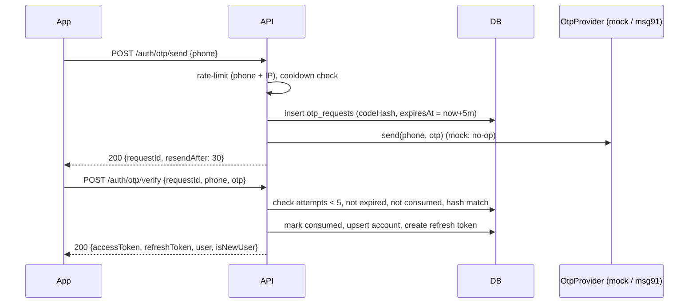
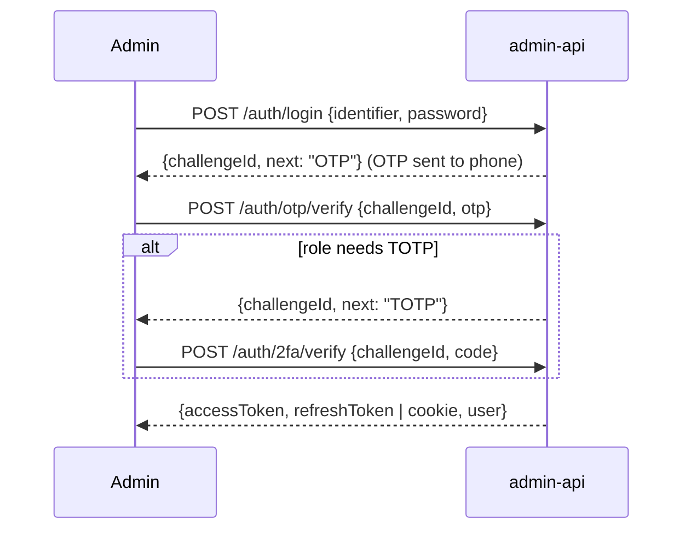
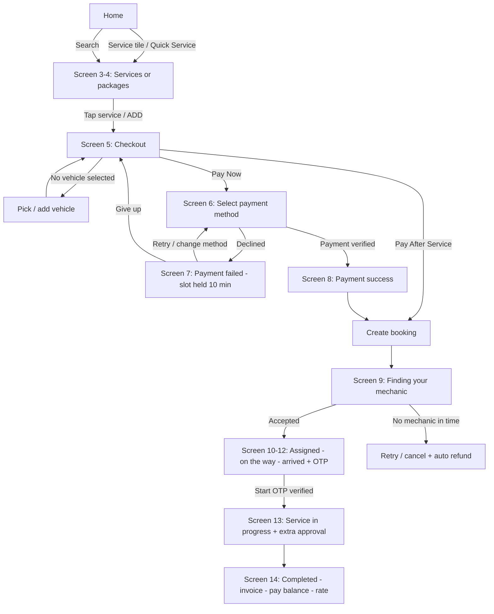
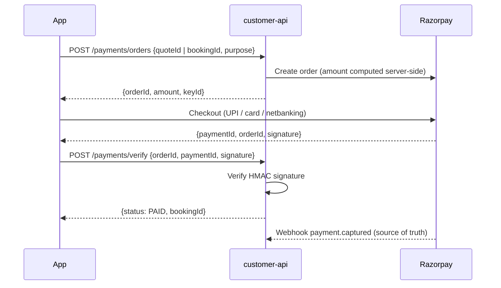
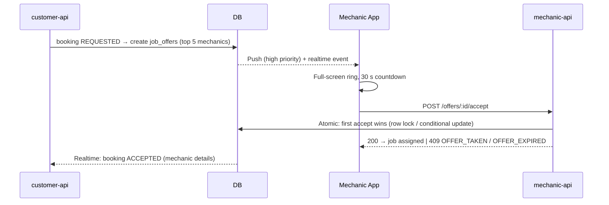

# GearZo – Individual App Specs

> Feature-level specs for each app. Follows the architecture and rules in [techStack.md](techStack.md).
> Copilot / AI assistants: implement e₹₹xactly what is specified here; if something is unclear, ask instead of guessing.

---

# Part 1 – Login & Authentication

## 1.0 Shared Auth Foundation (`packages/auth` + `packages/db`)

Used by all three APIs. Each API only wires it up with its own `APP_AUDIENCE` and `JWT_ACCESS_SECRET`.

### 1.0.1 Identity model

Customers, mechanics and admins are stored in **separate tables**. The same phone number can exist as a customer and a mechanic – they are different accounts.

| Table | Key fields |
|---|---|
| `customers` | `id (uuid)`, `phone (E.164, unique)`, `name?`, `email?`, `cityId?`, `profileState (PENDING \| SKIPPED \| COMPLETED)`, `status (ACTIVE \| BLOCKED)`, `tokenVersion`, `createdAt`, `lastLoginAt` |
| `mechanics` | `id`, `phone (unique)`, `name`, `areaId`, `registrationType (SHOP \| INDIVIDUAL \| DIRECT_JOB)`, `status (PENDING_PROFILE \| PENDING_KYC \| UNDER_REVIEW \| APPROVED \| REJECTED \| SUSPENDED)`, `tokenVersion`, `createdAt`, `lastLoginAt` |
| `admins` | `id`, `phone (unique)`, `email (unique)`, `name`, `role`, `jurisdictionId`, `passwordHash`, `totpSecretEnc?`, `totpEnabled`, `failedLoginCount`, `lockedUntil?`, `mustChangePassword`, `status (INVITED \| ACTIVE \| DISABLED)`, `tokenVersion`, `createdById` |
| `otp_requests` | `id`, `phone`, `audience (customer \| mechanic \| admin)`, `codeHash`, `attempts`, `expiresAt`, `consumedAt?`, `ip`, `createdAt` |
| `sessions` | `id`, `subjectId`, `audience`, `familyId`, `deviceId`, `deviceName?`, `platform (ios \| android \| web)`, `ip`, `userAgent`, `createdAt`, `lastUsedAt`, `idleExpiresAt`, `absoluteExpiresAt`, `revokedAt?`, `revokeReason?` |
| `refresh_tokens` | `id`, `sessionId`, `tokenHash`, `expiresAt`, `revokedAt?`, `replacedById?`, `createdAt` |
| `auth_events` | `id`, `subjectId?`, `audience`, `type (OTP_SENT \| OTP_FAILED \| LOGIN_SUCCESS \| LOGIN_FAILED \| LOGOUT \| TOKEN_REUSE_DETECTED \| LOCKED)`, `ip`, `userAgent`, `createdAt` |
| `system_settings` | `key (unique)`, `value (jsonb)`, `updatedById`, `updatedAt` – Super Admin overrides for limits (see §1.0.7) |

### 1.0.2 Tokens

| Token | Format | Lifetime | Storage (mobile) | Storage (web) |
|---|---|---|---|---|
| Access | JWT (`sub`, `aud`, `role`, `tokenVersion`, `jurisdictionId?`) | 15 min | Memory + `expo-secure-store` | Memory only |
| Refresh | Opaque 256-bit random, SHA-256 hashed in DB | Sliding – see §1.0.6 | `expo-secure-store` | `httpOnly; Secure; SameSite=Strict` cookie, path `/v1/auth` |

- **Rotation:** every `/auth/refresh` call revokes the old refresh token and issues a new one in the same `familyId`.
- **Reuse detection:** if a revoked refresh token is presented → revoke the whole family, log `TOKEN_REUSE_DETECTED`, return `401`.
- **Global logout:** increment `tokenVersion` → all access tokens become invalid at next check; revoke all refresh tokens.
- Access token guard checks: signature, `exp`, `aud === APP_AUDIENCE`, account `status`, `tokenVersion` match.

### 1.0.3 OTP flow (mock now, MSG91 later)



| Rule | Value |
|---|---|
| OTP length | 6 digits (`crypto.randomInt`) – mock always uses `MOCK_OTP_CODE` |
| Expiry | 5 minutes, single use |
| Verify attempts | Max 5 per OTP, then invalidated |
| Send limit | 3 per phone per 15 min; 10 per IP per 15 min |
| Resend cooldown | 30 seconds |
| Storage | Only the hash (`sha256(otp + requestId + OTP_PEPPER)`) |
| Logging | Never log or return the OTP |
| Errors | Generic: `OTP_INVALID_OR_EXPIRED` – never reveal whether the phone is registered |

**Mock mode:** `OTP_PROVIDER=mock` → `MockOtpProvider.send()` does nothing, the code is `MOCK_OTP_CODE` (default `123456`). The full flow (hashing, attempts, expiry, rate limits) still runs so switching to MSG91 later is a config change only. API refuses to boot in production with mock unless `ALLOW_MOCK_OTP_IN_PROD=true`.

### 1.0.4 Standard auth error codes

| HTTP | Code | When |
|---|---|---|
| 400 | `VALIDATION_ERROR` | Bad phone format / missing fields |
| 401 | `OTP_INVALID_OR_EXPIRED` | Wrong, expired, consumed OTP or too many attempts |
| 401 | `INVALID_CREDENTIALS` | Admin wrong email/phone or password |
| 401 | `TOKEN_EXPIRED` | Access token expired → client calls refresh |
| 401 | `SESSION_REVOKED` | Refresh token revoked / reused / tokenVersion mismatch / evicted by session limit |
| 401 | `SESSION_EXPIRED` | Idle or absolute session timeout reached – full login required |
| 403 | `ACCOUNT_BLOCKED` | Account blocked / suspended / disabled |
| 403 | `WRONG_APP` | Token `aud` does not match this API |
| 423 | `ACCOUNT_LOCKED` | Admin locked after failed attempts |
| 429 | `TOO_MANY_REQUESTS` | Rate limit / cooldown hit (`retryAfter` in response) |

### 1.0.5 Shared frontend auth (`packages/api-client`)

- `createApiClient({ baseURL, audience })` – axios instance with:
  - Request interceptor: attach `Authorization: Bearer <access>`.
  - Response interceptor: on `TOKEN_EXPIRED` → single in-flight refresh (queue other requests) → retry once. On `SESSION_REVOKED` → clear tokens, go to login.
- `useAuthStore` (Zustand): `status: 'loading' | 'signedOut' | 'signedIn'`, `user`, `signIn()`, `signOut()`.
- Tokens persisted only via `expo-secure-store` (native) or cookie (web refresh token).
- Shared Zod schemas in `packages/schemas/auth`: `phoneSchema` (Indian mobile → E.164), `otpSchema` (6 digits), `passwordSchema`.
- On `SESSION_EXPIRED` / `SESSION_REVOKED` → clear secure store, reset TanStack Query cache, show login with a message ("Session expired, please log in again").

### 1.0.6 Session management (expiry & limits)

One **session** = one logged-in device. Every refresh token belongs to a session.

#### Expiry

| Setting | Customer | Mechanic | Admin |
|---|---|---|---|
| Access token TTL | 15 min | 15 min | 10 min |
| **Idle timeout** (no API activity / refresh) | 30 days | 15 days | **30 min** |
| **Absolute timeout** (from login, cannot be extended) | 90 days | 60 days | **12 hours** |
| Re-auth for sensitive actions | OTP (delete account, change phone) | OTP (bank details, change phone) | Password + TOTP/OTP (invite admin, role change, refunds) – valid 5 min |

- **Sliding refresh:** each successful refresh sets `idleExpiresAt = now + idleTimeout`, capped at `absoluteExpiresAt`.
- Refresh after `idleExpiresAt` or `absoluteExpiresAt` → revoke session, return `SESSION_EXPIRED`.
- `lastUsedAt` is updated on refresh (not every request) to keep DB writes low.
- Admin app (mobile & web) also auto-locks the UI after **30 min of user inactivity** on the client, even if a request is in flight.

#### Max entries / limits

| Limit | Customer | Mechanic | Admin |
|---|---|---|---|
| **Max active sessions (devices)** | 5 | 2 (e.g. 1 phone + 1 web) | 2 (1 mobile + 1 web) |
| When limit exceeded | Revoke least-recently-used session | Revoke least-recently-used session | Revoke oldest session + alert admin + audit log |
| Max push tokens per account | 5 | 2 | 2 |
| Max active OTP requests per phone | 1 (new send invalidates previous) | 1 | 1 |
| OTP sends per phone | 3 / 15 min, 10 / day | 3 / 15 min, 10 / day | 3 / 15 min, 10 / day |
| OTP sends per IP | 10 / 15 min | 10 / 15 min | 10 / 15 min |
| OTP verify attempts | 5 per OTP | 5 per OTP | 5 per OTP |
| Admin login attempts (password / OTP / TOTP) | – | – | 5 → lock 15 min; 3 locks in 24 h → `DISABLED` until parent admin re-enables |
| Active admin login challenges | – | – | 3 per admin (oldest discarded) |
| Refresh calls per session | 30 / min (abuse guard) | 30 / min | 30 / min |

- Same `deviceId` logging in again **replaces** its old session (doesn't count twice). `deviceId` = random UUID generated on first app launch and stored in secure store.
- On eviction, send a push/SMS-free in-app notice to the remaining devices: "Logged out on <device> due to new login".
- All limits are configurable – see §1.0.7. Services must read them via `LimitsService`, never hard-code numbers.

#### Session endpoints (all three APIs)

| Method | Path | Auth | Purpose |
|---|---|---|---|
| GET | `/auth/sessions` | Access | List own active sessions (`id`, `deviceName`, `platform`, `lastUsedAt`, `current`) |
| DELETE | `/auth/sessions/:id` | Access | Log out a specific device (own sessions only) |
| POST | `/auth/logout` | Access | Revoke current session |
| POST | `/auth/logout-all` | Access | Revoke all sessions + bump `tokenVersion` |
| DELETE | `/admins/:id/sessions` | admin-api, permission | Force logout a lower-level admin in own jurisdiction |

#### Forced session revocation (automatic)

| Event | Effect |
|---|---|
| Account blocked / suspended / disabled | All sessions revoked, `tokenVersion++` |
| Phone number changed | All sessions revoked |
| Admin password changed / reset | All **other** sessions revoked |
| Admin role or jurisdiction changed | All sessions revoked |
| Refresh token reuse detected | That session's whole family revoked |

#### Cleanup (daily cron – Vercel Cron now, Cloud Scheduler later)

| Data | Retention |
|---|---|
| `otp_requests` | Delete 24 h after expiry |
| `refresh_tokens` / `sessions` (expired or revoked) | Delete after 30 days |
| `auth_events` | 180 days |
| `audit_logs` (admin) | 3 years – never deleted by app code |

### 1.0.7 Where limits are configured

Every limit in §1.0.3 and §1.0.6 has a **default in backend code**. Super Admin can override it from the Admin App. If no override exists, the code default is used.

#### Resolution order (first found wins)

```
1. system_settings (DB)   ← set by SUPER_ADMIN in Admin App
2. Environment variable   ← per API (Vercel project env) – optional, for emergencies/ops
3. Code default           ← packages/auth/src/limits.config.ts
```

The resolved value is **always clamped** to the code-defined `min` / `max`. Out-of-range values are rejected on save (admin-api) and ignored at runtime (fallback to default + error log).

#### Code defaults (`packages/auth/src/limits.config.ts`)

```ts
const MIN = 60;
const DAY = 86_400;

// key → default + allowed range; this file is the single source of truth for limits
export const LIMITS = {
  'session.customer.accessTtlSec':       { default: 15 * MIN, min: 5 * MIN,  max: 30 * MIN },
  'session.customer.idleTimeoutSec':     { default: 30 * DAY, min: 1 * DAY,  max: 60 * DAY },
  'session.customer.absoluteTimeoutSec': { default: 90 * DAY, min: 7 * DAY,  max: 180 * DAY },
  'session.customer.maxSessions':        { default: 5,        min: 1,        max: 10 },

  'session.mechanic.accessTtlSec':       { default: 15 * MIN, min: 5 * MIN,  max: 30 * MIN },
  'session.mechanic.idleTimeoutSec':     { default: 15 * DAY, min: 1 * DAY,  max: 30 * DAY },
  'session.mechanic.absoluteTimeoutSec': { default: 60 * DAY, min: 7 * DAY,  max: 90 * DAY },
  'session.mechanic.maxSessions':        { default: 2,        min: 1,        max: 3 },

  'session.admin.accessTtlSec':          { default: 10 * MIN, min: 5 * MIN,  max: 15 * MIN },
  'session.admin.idleTimeoutSec':        { default: 30 * MIN, min: 5 * MIN,  max: 60 * MIN },
  'session.admin.absoluteTimeoutSec':    { default: 12 * 3600, min: 1 * 3600, max: 24 * 3600 },
  'session.admin.maxSessions':           { default: 2,        min: 1,        max: 3 },

  'otp.ttlSec':                          { default: 300, min: 120, max: 600 },
  'otp.maxVerifyAttempts':               { default: 5,   min: 3,   max: 10 },
  'otp.resendCooldownSec':               { default: 30,  min: 15,  max: 120 },
  'otp.sendPerPhone15m':                 { default: 3,   min: 1,   max: 5 },
  'otp.sendPerPhoneDay':                 { default: 10,  min: 3,   max: 20 },
  'otp.sendPerIp15m':                    { default: 10,  min: 3,   max: 50 },

  'admin.maxFailedAttempts':             { default: 5,   min: 3,   max: 10 },
  'admin.lockDurationSec':               { default: 15 * MIN, min: 5 * MIN, max: 60 * MIN },
} as const;

export type LimitKey = keyof typeof LIMITS;
```

#### Environment variable override (optional)

Key → env name: uppercase, dots become `_`, prefixed with `LIMIT_`.
Example: `session.admin.idleTimeoutSec` → `LIMIT_SESSION_ADMIN_IDLE_TIMEOUT_SEC=900`.
Set in the API's Vercel project → Settings → Environment Variables → redeploy.

#### Runtime (`LimitsService` in `packages/auth`)

- `limits.get('session.customer.maxSessions'): Promise<number>`
- Reads `system_settings` through **Upstash Redis cache (TTL 60 s)** so all three APIs see the same value without hitting the DB on every request.
- When admin-api saves a setting it deletes the cache key → change applies to all APIs within seconds.
- If DB/Redis is unavailable → use env/code default (never fail open with "unlimited").
- New values apply to **new logins and next refresh**; existing sessions are re-checked against the new idle/absolute values on their next refresh.

#### Admin App – Settings screen (SUPER_ADMIN only)

```
apps/admin/app/(app)/settings/
├── security-limits.tsx      # Grouped: Customer sessions, Mechanic sessions, Admin sessions, OTP, Lockout
└── security-limits-history.tsx
```

- Shows for each key: current value, source (`DB` / `ENV` / `DEFAULT`), default, allowed range.
- Inputs in friendly units (minutes / days); API stores seconds.
- "Reset to default" removes the DB row.

| Method | Path | Auth | Notes |
|---|---|---|---|
| GET | `/settings/limits` | `SUPER_ADMIN` | `[{ key, value, source, default, min, max, updatedBy, updatedAt }]` |
| PUT | `/settings/limits/:key` | `SUPER_ADMIN` + re-auth (TOTP, valid 5 min) | `{ value }` – validated against `min`/`max`; unknown keys rejected |
| DELETE | `/settings/limits/:key` | `SUPER_ADMIN` + re-auth | Reset to env/code default |
| GET | `/settings/limits/history` | `SUPER_ADMIN` | From `audit_logs` (before/after values) |

**Rules:** only `SUPER_ADMIN`; every change written to `audit_logs` with before/after; other admins can't view or change limits; customer-api and mechanic-api only **read** settings, never write.

---

## 1.1 Customer App – Login & Authentication

**API:** `customer-api` (`https://api.gearzo.in/v1`) · **Audience:** `customer` · **Platforms:** iOS, Android, Web (`customer.gearzo.in`)

### Screens (Expo Router)

```
app/
├── (auth)/
│   ├── welcome.tsx          # Intro + "Continue with mobile number"
│   ├── phone.tsx            # Enter mobile number (+91 fixed)
│   ├── otp.tsx              # 6-digit OTP input, resend timer, edit number
│   └── register.tsx         # Optional basic details; "Skip" stays visible at the top
└── (app)/...                # Protected – redirect to (auth) if signedOut
```

### Flow

1. App start → native reads the refresh token from secure store; web sends its refresh cookie → `POST /auth/refresh`. Success → `(app)`, failure → `(auth)/welcome`.
2. Enter phone → `POST /auth/otp/send`.
3. Enter OTP → `POST /auth/otp/verify` → store tokens.
4. `isNewUser = true` → optional basic details (§2.2). Submit → `POST /me/profile`; Skip → `POST /me/profile/skip`. Both continue to home.
5. Register push token after login → `POST /me/devices`.

### Endpoints

| Method | Path | Auth | Body | Response |
|---|---|---|---|---|
| POST | `/auth/otp/send` | Public | `{ phone }` | `{ requestId, resendAfter }` |
| POST | `/auth/otp/verify` | Public | `{ requestId, phone, otp, device: { id, name, platform } }` | `{ accessToken, refreshToken, expiresIn, isNewUser, user }` |
| POST | `/auth/refresh` | Refresh token | `{ refreshToken }` | `{ accessToken, refreshToken, expiresIn }` |
| POST | `/auth/logout` | Access | `{ refreshToken }` | `204` |
| POST | `/auth/logout-all` | Access | – | `204` |
| GET | `/me` | Access | – | `{ id, phone, name, email }` |
| PATCH | `/me` | Access | `{ name, email? }` | `{ ...user }` |
| POST | `/me/profile` | Access | `{ name, email?, cityId }` | `{ ...user, profileState: COMPLETED }` |
| POST | `/me/profile/skip` | Access | – | `204` |
| POST | `/me/devices` | Access | `{ expoPushToken, platform }` | `204` |
| DELETE | `/me` | Access | `{ otp }` (re-verify) | `204` – account deletion (Play/App Store requirement) |

### Rules

- New customer account is created automatically on first successful OTP verify (`isNewUser = true`).
- Login is by mobile number + OTP only on iOS, Android and web; do not add email/password or social login.
- Basic profile completion is optional. A customer who skips can browse and use the app; any details required to place an order are collected during checkout.
- `BLOCKED` customers get `ACCOUNT_BLOCKED` at verify and refresh.
- Account deletion requires a fresh OTP; anonymise personal data, keep bookings for records.
- **Web:** refresh token in an `httpOnly`, `Secure`, `SameSite=Strict` cookie, access token in memory; CORS only `https://customer.gearzo.in`; check the `Origin` header on refresh and other cookie-authenticated endpoints.

---

## 1.2 Mechanic App – Login & Authentication

**API:** `mechanic-api` (`https://mechanic-api.gearzo.in/v1`) · **Audience:** `mechanic` · **Platforms:** Android, Web (`mechanic.gearzo.in`)

### Screens

```
app/
├── (auth)/
│   ├── welcome.tsx
│   ├── phone.tsx
│   └── otp.tsx
├── (onboarding)/            # Shown until status = APPROVED – full spec in §3.2
│   ├── type.tsx             # Shop / Individual Mechanic / Accept Service Jobs Directly
│   ├── profile.tsx          # Personal / shop details
│   ├── skills.tsx           # Vehicle types + services offered
│   ├── location.tsx         # Base location + service radius
│   ├── kyc.tsx              # Aadhaar / PAN / DL, selfie
│   ├── bank.tsx             # Bank / UPI for payouts
│   ├── under-review.tsx     # Waiting for admin approval
│   └── rejected.tsx         # Reason + re-submit
└── (app)/...                # Jobs, availability, earnings – APPROVED only
```

### Flow

1. Phone → OTP → verify (same as customer, separate account table).
2. A new mechanic chooses `SHOP`, `INDIVIDUAL`, or `DIRECT_JOB` before entering the matching onboarding flow.
3. Route by `mechanic.status`:

| Status | Goes to | Can do |
|---|---|---|
| `PENDING_PROFILE` | `onboarding/type` if no type, otherwise `onboarding/profile` | Choose type / edit profile |
| `PENDING_KYC` | `onboarding/kyc` | Upload KYC |
| `UNDER_REVIEW` | `onboarding/under-review` | View status only |
| `REJECTED` | `onboarding/rejected` | Fix & resubmit KYC |
| `APPROVED` | `(app)` | Everything |
| `SUSPENDED` | Blocked screen | Nothing (`ACCOUNT_BLOCKED`) |

### Endpoints

| Method | Path | Auth | Notes |
|---|---|---|---|
| POST | `/auth/otp/send` | Public | Same contract as customer |
| POST | `/auth/otp/verify` | Public | Response includes `user.status` |
| POST | `/auth/refresh` | Refresh token | Mobile: body. Web: cookie |
| POST | `/auth/logout`, `/auth/logout-all` | Access | |
| GET / PATCH | `/me` | Access | Profile fields |
| PUT | `/onboarding/type` | Access (`PENDING_PROFILE`) | `{ registrationType: SHOP \| INDIVIDUAL \| DIRECT_JOB }` |
| POST | `/me/devices` | Access | Push token |
| POST | `/kyc` | Access (`PENDING_KYC` / `REJECTED`) | Signed upload URLs; status → `UNDER_REVIEW` |
| GET | `/kyc` | Access | Current KYC status + rejection reason |

### Rules

- Guard `@RequireMechanicStatus('APPROVED')` on all job, availability, location and earnings endpoints.
- `registrationType` becomes immutable after KYC submission; changing it later requires an audited admin-assisted re-onboarding.
- Status changes (approve/reject/suspend) only happen in `admin-api`; on suspend, bump `tokenVersion` so sessions end immediately.
- KYC files: private bucket, allowlisted types (`jpg`, `png`, `pdf`), max 5 MB, signed URLs expire in 5 min. Never return raw document URLs.
- **Web:** refresh token in `httpOnly` cookie, access token in memory; CORS only `https://mechanic.gearzo.in`; CSRF protected via `SameSite=Strict` + `Origin` header check on `/auth/refresh`.

---

## 1.3 Admin App – Login & Authentication

**API:** `admin-api` (`https://admin-api.gearzo.in/v1`) · **Audience:** `admin` · **Platforms:** iOS, Android, Web (`admin.gearzo.in`)

### No self sign-up

Admins are **invited** by a higher-level admin (see techStack.md §4.3). The first `SUPER_ADMIN` is created by a one-time CLI seed script (`pnpm --filter admin-api seed:super-admin`) – never via an API endpoint.

### Screens

```
app/
├── (auth)/
│   ├── login.tsx            # Email or phone + password
│   ├── otp.tsx              # OTP sent to registered phone
│   ├── totp.tsx             # Authenticator code (Divisional & Super)
│   ├── accept-invite.tsx    # Set password (+ TOTP enrolment) from invite link
│   ├── setup-totp.tsx       # QR code + verify first code
│   ├── forgot-password.tsx
│   └── reset-password.tsx
└── (app)/...                # Menus shown based on role permissions
```

### Login flow (multi-step)



- `challengeId`: random, stored server-side, 5-minute expiry, bound to admin + IP, single use per step. Steps must be completed in order.
- `mustChangePassword = true` → force `change-password` before anything else.

### Endpoints

| Method | Path | Auth | Body / Notes |
|---|---|---|---|
| POST | `/auth/login` | Public | `{ identifier, password }` → `{ challengeId, next }` |
| POST | `/auth/otp/verify` | Challenge | `{ challengeId, otp }` → `{ challengeId, next }` or tokens |
| POST | `/auth/2fa/verify` | Challenge | `{ challengeId, code }` → tokens |
| POST | `/auth/refresh` | Refresh token | Mobile: body. Web: cookie |
| POST | `/auth/logout`, `/auth/logout-all` | Access | |
| POST | `/auth/invite/accept` | Invite token | `{ inviteToken, password }` → `{ challengeId, next: "TOTP_SETUP" \| "OTP" }` |
| POST | `/auth/2fa/setup` | Challenge / Access | → `{ otpauthUrl }` (QR) |
| POST | `/auth/2fa/confirm` | Challenge / Access | `{ code }` → enables TOTP, returns one-time recovery codes |
| POST | `/auth/password/forgot` | Public | `{ identifier }` → always `202` (no user enumeration) |
| POST | `/auth/password/reset` | Reset token | `{ resetToken, otp, newPassword }` |
| POST | `/auth/password/change` | Access | `{ currentPassword, newPassword }` → revokes other sessions |
| GET | `/me` | Access | `{ id, name, role, jurisdiction, permissions[] }` |
| POST | `/admins/invite` | Access + permission | `{ name, phone, email, role, jurisdictionId }` – role must be lower, jurisdiction inside own subtree |

### TOTP requirement

| Role | OTP | TOTP |
|---|---|---|
| `SUPER_ADMIN` | ✅ | ✅ mandatory |
| `DIVISIONAL_ADMIN` | ✅ | ✅ mandatory |
| `SUB_DIVISIONAL_ADMIN` | ✅ | Optional |
| `AREA_ADMIN` | ✅ | Optional |

### Rules

- Passwords: `argon2id`, min 10 chars, must not equal phone/email; reject top common passwords.
- **Lockout:** 5 failed password/OTP/TOTP attempts → `lockedUntil = now + 15 min`, log `LOCKED`, notify the admin's parent admin.
- Invite and reset tokens: random 256-bit, hashed in DB, 24 h (invite) / 15 min (reset), single use.
- TOTP secret encrypted at rest (`AES-256-GCM`, key from env `TOTP_ENC_KEY`); recovery codes hashed.
- Every login, logout, failed attempt, invite, role change and password change → `audit_logs`.
- Disabling an admin or changing their role/jurisdiction bumps `tokenVersion` (immediate logout).
- **Web:** refresh token in `httpOnly; Secure; SameSite=Strict` cookie, access token in memory only; CORS only `https://admin.gearzo.in`; idle timeout 30 min.
- Session: 30 min idle, 12 h absolute, max 2 active sessions (see §1.0.6) – full MFA login after expiry.

---

## 1.4 Auth Test Checklist (all apps)

- [ ] OTP send rate limits (phone + IP) and 30 s cooldown.
- [ ] OTP: wrong code, expired, reused, 6th attempt → all `OTP_INVALID_OR_EXPIRED`.
- [ ] Mock provider blocked in production unless `ALLOW_MOCK_OTP_IN_PROD=true`.
- [ ] Refresh rotation works; reused refresh token revokes the family.
- [ ] Idle and absolute timeouts return `SESSION_EXPIRED` per audience (§1.0.6).
- [ ] Exceeding max sessions evicts the least-recently-used session; same `deviceId` doesn't create a duplicate.
- [ ] User can list and revoke own sessions only; admin can force-logout only lower admins in own jurisdiction.
- [ ] Cleanup cron deletes expired OTPs/sessions and never touches `audit_logs`.
- [ ] Limits resolve DB → env → default; out-of-range values rejected on save and clamped at runtime.
- [ ] Only `SUPER_ADMIN` (with re-auth) can change limits; change is audited and visible to all APIs within 60 s.
- [ ] Customer token rejected by `mechanic-api` and `admin-api` (`WRONG_APP`), and vice versa.
- [ ] Blocked / suspended / disabled accounts can't log in or refresh.
- [ ] Mechanic not `APPROVED` gets `403` on job endpoints.
- [ ] Admin: login steps can't be skipped; lockout after 5 failures; TOTP mandatory for Divisional & Super.
- [ ] Admin can't invite same/higher role or outside own jurisdiction.
- [ ] No OTP, password, token or full phone number appears in logs.

---

# Part 2 – Customer App (Vehicles, Services, Booking, Payment)

**App:** `apps/customer` · **API:** `customer-api` · **Team:** Customer team

## 2.1 Navigation

```
app/
├── (auth)/                        # Part 1 + optional basic-details screen
└── (app)/
    ├── (tabs)/
    │   ├── index.tsx              # Screen 1–2  Home (+ scrolled Quick Services)
    │   ├── bookings.tsx           # Screen 15–16 My Bookings (list + empty state)
    │   ├── subscription.tsx       # Screen 17 Subscription plans / My Subscription
    │   └── profile.tsx            # Screen 18 Profile
    ├── search.tsx                 # Service / repair / mechanic search
    ├── vehicles/
    │   ├── add.tsx                # Add vehicle wizard
    │   └── [id].tsx               # Vehicle detail / edit / delete
    ├── services/
    │   ├── index.tsx              # Screen 3–4 Services / packages (?vehicleType=)
    │   └── [id].tsx               # Service / package detail ("View Details")
    ├── booking/
    │   ├── checkout.tsx           # Screen 5 Checkout (single page)
    │   ├── payment.tsx            # Screen 6 Select payment method
    │   ├── payment-failed.tsx     # Screen 7 Payment failed + slot hold
    │   ├── confirmed.tsx          # Screen 8 Payment success
    │   └── [id]/
    │       ├── searching.tsx      # Screen 9  Finding your mechanic
    │       ├── track.tsx          # Screen 10–12 Assigned → on the way → arrived (OTP)
    │       ├── progress.tsx       # Screen 13 Service in progress + extra approval
    │       └── invoice.tsx        # Screen 14 Completed: bill, pay balance, rate
    ├── subscription/
    │   └── [id].tsx               # Plan details
    ├── profile/
    │   ├── edit.tsx               # Name, email
    │   ├── upcoming.tsx           # Upcoming services
    │   ├── order-history.tsx      # Order history
    │   ├── rewards.tsx            # Rewards (Coming Soon)
    │   ├── settings.tsx           # Settings + sessions
    │   ├── legal.tsx              # Terms & Privacy
    │   └── help.tsx               # Help / support
    └── addresses/
        ├── index.tsx
        └── edit.tsx
```

> Screen numbers refer to the GearZo App Flow document. Every screen in that document must exist in the app; §2.3–§2.13 specify each one.

## 2.2 Registration

Shown after the first OTP verification (`isNewUser = true`) as an optional basic-details screen. A **Skip** action must remain visible in the top-right corner. Submitting or skipping takes the customer to Home; profile completion never blocks browsing.

| Field | Required | Validation |
|---|---|---|
| Full name | Required only on submit | 2–50 chars, letters/spaces/`.` only |
| Mobile | — | Pre-filled from OTP, read-only |
| Email | ❌ | Valid email; used for invoices |
| City | Required only on submit | Pick from serviceable cities (`GET /cities`) – launch city: **Hyderabad** |
| Primary vehicle | ❌ | "Add now" opens add-vehicle wizard, or "Skip" |
| Terms & Privacy consent | Required before first order | Checkbox; store `termsVersion` + `acceptedAt` |
| Referral code | ❌ | Phase 2 |

- `POST /me/profile` `{ name, email?, cityId }` → sets `profileState = COMPLETED`.
- `POST /me/profile/skip` → sets `profileState = SKIPPED`; it does not invent placeholder customer data.
- A skipped customer may browse services, manage vehicles and start checkout. Checkout collects any missing required details and may save them back to the profile only with the customer's explicit consent.
- Do not return `REGISTRATION_REQUIRED` for an incomplete profile. Booking validation returns field-specific errors only when data required for that order is missing.

## 2.3 Home Screen

The Home screen is one vertically scrollable page. Components appear in this exact order:

```
┌──────────────────────────────────────┐
│ Hey, {firstName or friendly name} 👋 │
│ 📍 {saved/current address} ▾     🔔  │  Dark-green header
├──────────────────────────────────────┤
│ 🔍 Search service, repair or         │
│    mechanic...                    →  │  Overlaps header/content edge
├──────────────────────────────────────┤
│ ＋  Add your vehicle          + Add  │
│    Accurate pricing & faster booking │  Show when no vehicle is selected
├──────────────────────────────────────┤
│ ₹150 OFF on your 1st booking*        │
│ Quick Service · Trusted Mechanics ·  │  Swipeable promotion banner
│ Premium Care                         │
│                  ● ○ ○ ○             │
├───────────────────┬──────────────────┤
│ 2-Wheeler Service │ 4-Wheeler Service│
├───────────────────┼──────────────────┤
│ Washing &         │ Shop Now         │
│ Detailing         │ Spares & Acc.    │
│ Coming Soon       │ Coming Soon      │
├──────────────────────────────────────┤
│          ✦ Quick Services ✦          │
├──────────────────────────────────────┤
│ Service Packages                     │
│ Complete service made easy           │
├───────────────────┬──────────────────┤
│ Specific Repair   │ Book a Mechanic  │
│ Get help          │ Expert mechanics │
│ immediately       │ at your doorstep │
├──────────────────────────────────────┤
│ [Car image] Book your Car Service Now│
│                         [Book Now]    │
├──────────────────────────────────────┤
│              Gearzo Promise          │
│ Trusted service. Verified experts.   │
│ Happy customers.                     │
└──────────────────────────────────────┘
                         [🎧 Support]    Floating button
┌──────────────────────────────────────┐
│ Home │ Booking │ Subscription │Profile│ Fixed bottom navigation
└──────────────────────────────────────┘
```

| Tap | Goes to | Behaviour |
|---|---|---|
| Address | Address picker sheet | Displays the saved/current address and changes the location used for serviceability and pricing. |
| Notification bell | Notifications | Shows unread state with a badge. |
| Search field / arrow | Service search | Searches services, repairs and "Book a Mechanic"; recent and suggested searches appear before typing. |
| `+ Add` vehicle prompt | `vehicles/add` | Opens the add-vehicle wizard. When vehicles exist, show the selected vehicle and a Change action in the same position. |
| Promotion banner | Configured campaign target | Swipeable carousel. The first configured banner is the ₹150 first-booking offer shown in the flow document. |
| `2-Wheeler Service` | `services?vehicleType=TWO_WHEELER` | Opens 2-wheeler services. |
| `4-Wheeler Service` | `services?vehicleType=FOUR_WHEELER` | Opens 4-wheeler services. |
| `Washing & Detailing` | — | Disabled card with a visible `Coming Soon` label; no navigation. |
| `Shop Now – Spares & Accessories` | — | Disabled card with a visible `Coming Soon` label; no navigation. |
| `Service Packages` | `services?category=SERVICE_PACKAGES` | Opens package services. |
| `Specific Repair` | `services?category=SPECIFIC_REPAIR` | Opens individual repair services. |
| `Book a Mechanic` | `services?service=BOOK_A_MECHANIC` | Opens the Book a Mechanic service flow. |
| `Book your Car Service Now` / `Book Now` | `services?vehicleType=FOUR_WHEELER` | Opens 4-wheeler services. |
| Floating support button | Help and support | Opens support options without leaving the current tab state. |

- Keep the dark-green greeting/address header and search field visible at the top of the initial viewport.
- The first viewport ends after the four primary service tiles. Scrolling reveals **Quick Services**, the car-service CTA and **Gearzo Promise**, as shown in the flow document.
- Do not add a 3-wheeler tile, My Vehicles carousel, Emergency banner or Popular Services section to this Home layout unless a later approved design replaces the supplied flow.
- The bottom navigation is always `Home`, `Booking`, `Subscription`, `Profile`; Home is selected on this screen.
- Web uses the same content order in a centered responsive container; wider layouts may increase card width but must not reorder or omit sections.
- Home data in one call: `GET /home?lat&lng` → `{ greetingName, address, serviceable, selectedVehicle?, unreadNotificationCount, promoBanners[], primaryServiceTiles[], quickServices[], carServiceCta, promise }`.
- If location is **not serviceable** → show "We're not in your area yet" + notify-me option; disable booking.

## 2.4 My Vehicles

### Add vehicle wizard

```
1. Type        → 2W / 3W / 4W
2. Brand       → searchable list (Honda, Bajaj, Maruti, ...)
3. Model       → filtered by brand + type (Activa 6G, Pulsar 150, Swift, ...)
4. Fuel        → Petrol / Diesel / CNG / Electric (filtered by model)
5. Details     → Registration no. (optional for 2W/3W, recommended), Year, Nickname ("Dad's car")
```

| Rule | Value |
|---|---|
| Max vehicles per customer | 10 (configurable via §1.0.7 key `customer.maxVehicles`) |
| Registration number | Optional; uppercase, format `^[A-Z]{2}[0-9]{1,2}[A-Z]{0,3}[0-9]{4}$` (e.g. `TS09AB1234`); unique per customer |
| Default vehicle | One per customer; used for quick booking |
| Delete | Soft delete; not allowed while vehicle has an active booking |
| Brand/Model not listed | "Other" → free-text model name (flagged for admin to add to catalogue) |

### Endpoints

| Method | Path | Notes |
|---|---|---|
| GET | `/vehicle-types` | `[{ code: TWO_WHEELER \| THREE_WHEELER \| FOUR_WHEELER, name, icon }]` |
| GET | `/vehicle-brands?type=` | Master data (cached 24 h) |
| GET | `/vehicle-models?brandId=&type=` | Master data (cached 24 h) |
| GET | `/vehicles` | Customer's vehicles |
| POST | `/vehicles` | `{ type, brandId, modelId?, customModel?, fuelType, regNumber?, year?, nickname? }` |
| PATCH | `/vehicles/:id` | Own vehicle only |
| DELETE | `/vehicles/:id` | Soft delete |
| POST | `/vehicles/:id/default` | Set default |

## 2.5 Services Catalogue

Managed by `SUPER_ADMIN` in Admin App (techStack §4.3 – "Pricing & service catalogue").

### Example categories

| Category | 2W | 3W | 4W |
|---|---|---|---|
| **Emergency** – breakdown, puncture, battery jump-start, fuel delivery, towing | ✅ | ✅ | ✅ |
| **Periodic service** – general service, oil change, filter change | ✅ | ✅ | ✅ |
| **Repairs** – brakes, clutch, chain/sprocket, electrical, AC (4W) | ✅ | ✅ | ✅ |
| **Inspection** – pre-purchase check, diagnosis visit | ✅ | ✅ | ✅ |
| **Cleaning** – wash, interior cleaning (phase 2) | ✅ | ✅ | ✅ |

### Pricing model

- Price defined per **service × vehicle type**, optionally overridden per **model** and/or **area**.
- Resolution: `area+model` → `model` → `area+type` → `type` (base).
- Each service has `priceType`: `FIXED` (exact) or `STARTING_FROM` (estimate; final after inspection).
- Visit/diagnosis fee applies if customer cancels after mechanic arrives or declines the estimate.
- All amounts in **paise**, computed **only on the server**.
- Platform fee: `FLAT` or `PERCENT`, set by Super Admin (`fee_rules`).
- **GST:** not registered yet → `gst.enabled = false`; GST line hidden from quotes/invoices. When registered, Super Admin enables it with an effective date (past bookings unchanged).
- Each service defines `allowedModes[]` (`DOORSTEP`, `PICKUP_DROP`, `GARAGE_VISIT`, `TOWING`); checkout shows only the allowed ones (§2.6).

### Screens

#### Screen 3 – 2-Wheeler services list

```
┌──────────────────────────────────────┐
│ ‹ 2-Wheeler        🔍  🏍 Add Vehicle ▾│
├──────────────────────────────────────┤
│ What does your vehicle need today?   │
├──────────────────────────────────────┤
│ General Service        7-Day Warranty*│
│ Save Upto ₹3000           [Buy Now]  │
├──────────────────────────────────────┤
│ Book a Mechanic │ Service Packages │ …│  Category chips
├──────────────────────────────────────┤
│ Book A Mechanic          • 30 Mins   │
│ ₹299            7-Day Guarantee*     │
│ View Details                         │
├──────────────────────────────────────┤
│ Check My Vehicle         • 60 Mins   │
│ ₹299                                 │
│ View Details                         │
├──────────────────────────────────────┤
│ Consultation (Via Call)  • 15 Mins   │
│                        Save ₹30      │
└──────────────────────────────────────┘
```

| Element | Behaviour |
|---|---|
| Header | Back arrow, vehicle type title, search icon, and an **Add Vehicle / selected vehicle** dropdown. Picking a vehicle re-resolves prices for that model. |
| Highlight banner | Promoted service (e.g. General Service, "Save Upto ₹3000") with a `Buy Now` action. |
| Category chips | Horizontally scrollable: Book a Mechanic, Service Packages, Specific Repair, … Filters the list below. |
| Service card | Name, duration (`• 30 Mins`), price, optional `7-Day Warranty*` / `7-Day Guarantee*` badge, optional `Save ₹X` badge, and `View Details`. |
| Tap card | Goes **straight to Checkout** (§2.6) with that single service selected. |
| `View Details` | Opens service detail; detail page also has a primary action that goes to Checkout. |

#### Screen 4 – 4-Wheeler packages list

```
┌──────────────────────────────────────┐
│ ‹ 4-Wheeler        🔍  ＋ Add Vehicle │
├──────────────────────────────────────┤
│ 4-Wheeler │ Book A Mechanic │ Consultant│
├──────────────────────────────────────┤
│ Mechanic Consultation                │
│ ⚙ 7 Package Items                    │
│ ✓ 7 CHECK                            │
│ ₹299                        [ADD]    │
│ Order amount is ₹299                 │
├──────────────────────────────────────┤
│ Basic Periodic Service               │
│ ⚙ 13 Package Items                   │
│ ✓ 13 CHECK  🔧 4 REPAIR  ⟳ 2 REPLACE │
│ ₹2,499                      [ADD]    │
│ Order amount is ₹2,499               │
├──────────────────────────────────────┤
│ Standard Periodic Service            │
│ ⚙ 18 Package Items                   │
│ ✓ 18 CHECK  🔧 15 REPAIR ⟳ 3 REPLACE │
│ ₹2,499                      [ADD]    │
└──────────────────────────────────────┘
```

| Element | Behaviour |
|---|---|
| Package card | Package name, total package-item count, and the `CHECK` / `REPAIR` / `REPLACE` counts, price, and an `ADD` button. |
| `Order amount is ₹X` | Server-computed total for that package, shown under the card. |
| `ADD` / card tap | Goes **straight to Checkout** (§2.6) with that package selected. |

- A package is a service with `isPackage = true` and a list of `package_items`, each typed `CHECK`, `REPAIR` or `REPLACE`. Counts shown on the card are derived from those items — never hard-coded in the app.
- Cart rule: one booking covers **one vehicle**. Selecting a new service or package from the list replaces the current selection unless the customer explicitly adds more.
- **Service detail ("View Details"):** description, package items grouped by `CHECK` / `REPAIR` / `REPLACE`, what's included / not included, duration, warranty badge, price, and the Checkout action.

### Endpoints

| Method | Path | Notes |
|---|---|---|
| GET | `/service-categories?vehicleType=` | Category chips |
| GET | `/services?vehicleType=&vehicleId=&categoryId=&lat=&lng=` | Prices resolved for location + vehicle; includes `durationMin`, `badges[]`, `savingsPaise?`, `isPackage`, `itemCounts { check, repair, replace }` |
| GET | `/services/:id?vehicleId=&lat=&lng=` | Detail + `packageItems[]` |
| GET | `/search?q=&vehicleType=` | Service / repair / mechanic search from the Home search bar |

## 2.6 Booking Flow



### Screen 5 – Checkout

The document uses **one** Checkout page, not a multi-step wizard. Sections in this order:

```
┌──────────────────────────────────────┐
│ ‹ Checkout                           │
├──────────────────────────────────────┤
│ Booking for vehicle                  │
│ Selected vehicle                     │
│ Pulsar 220F (AP40EU4136)      Change │
├──────────────────────────────────────┤
│ Booking address             [Change] │
│ HOME · 119–120, Madhapur 500081      │
├──────────────────────────────────────┤
│ Select your service type             │
│ ( • Doorstep )  ( Pickup-Drop )      │
│ ETA: 30–45 mins                      │
├──────────────────────────────────────┤
│ ( • Instant )   ( Schedule )         │
│ Fastest available mechanic           │
│ Estimated arrival: 30–45 mins        │
├──────────────────────────────────────┤
│ Item  ·  Instructions  ·  Coupon     │
├──────────────────────────────────────┤
│ Billing details (GST included)       │
├──────────────────────────────────────┤
│ [ Pay After Service ] [ Pay Now ₹299]│
│   Cash or UPI          Secure UPI,   │
│                        card          │
└──────────────────────────────────────┘
```

| Section | Details |
|---|---|
| **Booking for vehicle** | Shows the selected vehicle as `Model (RegNumber)` with a Change action. If no vehicle exists, the add-vehicle wizard opens first and returns to Checkout. |
| **Booking address** | Saved address with its label (`HOME` / `WORK` / `OTHER`) and a Change action opening the address picker/map. Server resolves `areaId`; non-serviceable blocks checkout. |
| **Service type** | `DOORSTEP` (mechanic comes to the customer) or `PICKUP_DROP` (GearZo collects the vehicle, services it at the shop and returns it). Shows the ETA for the selected type. Only types allowed by the selected service are shown. |
| **Timing** | `INSTANT` ("Fastest available mechanic", estimated arrival 30–45 mins) or `SCHEDULE` (date + 1-hour slot, up to 7 days ahead). |
| **Booking for** | `MYSELF` or `SOMEONE_ELSE`. `SOMEONE_ELSE` requires recipient name and mobile number; relationship optional (§ Rules). |
| **Item** | The selected service or package with price and duration; packages list their `CHECK` / `REPAIR` / `REPLACE` counts. |
| **Instructions** | Optional free-text note for the mechanic (max 500 chars). |
| **Coupon** | Apply / remove a coupon code; the server validates eligibility and returns the discount. First-booking offers (e.g. ₹150 OFF) apply here. |
| **Billing details** | Server-computed breakdown: item total, discount, visit fee, platform fee, taxes & fees, and the payable total. GST is included in the displayed amounts while `gst.enabled = true`; otherwise the GST line is hidden (§2.5). |
| **Missing profile data** | A customer who skipped registration is asked here for only the fields this order needs, plus Terms & Privacy consent if not yet accepted (§2.2). |
| **Pay After Service** | Creates the booking immediately with `paymentMethod = CASH_OR_UPI_ON_COMPLETION`. Only shown when the resolved payment policy allows `POSTPAID` (§2.7.1). |
| **Pay Now ₹X** | Goes to Screen 6 with the server-computed amount. |

- `POST /bookings/quote` refreshes the breakdown whenever vehicle, address, service type, timing or coupon changes. Quotes expire after 10 minutes.
- `POST /bookings` is sent with an `Idempotency-Key`. Server re-calculates every amount — client totals are display-only.

### Screens 6–8 – Payment

| Screen | Details |
|---|---|
| **6 · Select payment method** | Header shows `Amount payable` and the booking code (`GZ-48213`). **UPI is listed first and marked `RECOMMENDED`** – installed UPI apps (Google Pay, PhonePe, Paytm), saved `name@bank` IDs and `Add new UPI ID`. Then `MORE WAYS TO PAY`: Credit / Debit Card (Visa, Mastercard, RuPay), Net Banking, Wallets. Footer: `Pay ₹X` and a `100% secure payments` note. |
| **7 · Payment failed** | Shown when the bank declines. Message: the payment was declined and **no money was deducted**. Shows Amount, Booking ID and a live `Slot held for MM:SS` countdown — the slot is reserved for **10 minutes** so the customer can retry. Actions: `Retry Payment`, `Change Payment Method`, `Contact Support`. When the hold expires, the slot is released and the customer returns to Checkout to re-quote. |
| **8 · Payment success** | `Booking confirmed!` with `Payment of ₹X received • Booking ID GZ-XXXXX`, and a summary of Service, Vehicle, Slot and Address. Message: "We are now finding the best mechanic near you." Actions: `Track Mechanic` (→ Screen 9) and `View Booking`. |

- The slot hold is server-side (`booking_slot_holds`, 10 min TTL, configurable via §1.0.7 key `booking.slotHoldMinutes`). The client only renders the remaining time returned by the API.
- Never show a failure reason from the gateway verbatim; show the standard declined message.
- Payment verification and webhook rules are in §2.7.

### Screens 9–12 – Finding and tracking the mechanic

| Screen | Details |
|---|---|
| **9 · Finding your mechanic** | "Finding the best mechanic near you…" with "This usually takes under 2 minutes", the booking code, and a summary line (service • vehicle • time • area). Action: `Cancel booking` (free at this stage). On timeout → `NO_MECHANIC_FOUND` (§ Step details). |
| **10 · Mechanic assigned** | Shows the **4-digit Start OTP** (e.g. `4827`), "{Mechanic} arrives by {time}", the mechanic card (photo, name, rating, jobs completed, years of experience, `Verified` badge) and a status timeline: `Booking confirmed` → `Payment received` → `Mechanic assigned` → `Mechanic on the way` → `Service completed`, each with its timestamp. Actions: `Cancel`, `Chat / Help`. |
| **11 · Mechanic on the way** | Live map with the mechanic's position, `Arriving in N min • X km`, mechanic name, rating, vehicle number and type, and the note "Live location is being shared". Actions: `Call`, `Chat`, `Share ETA`, `Safety`. Reminder: "Share the OTP {code} only when the mechanic arrives." |
| **12 · Mechanic arrived** | `Mechanic arrived` with the mechanic's name, vehicle number, rating and `Verified` badge. The 4-digit OTP is displayed in separate boxes with the instruction "Share this OTP to start service" and the warning "Verify the mechanic's name and vehicle number before sharing the code." Footer: service • duration, vehicle • area, and `Need help? Contact support`. |

- The Start OTP is **4 digits**, generated server-side, stored hashed (`bookings.startOtpHash`) and never logged. It is shown to the customer only and is entered by the mechanic to move the job to `IN_PROGRESS`.
- Live mechanic location is shown only between `ACCEPTED` and `ARRIVED` (Part 3 §3.10).
- Screens 10–12 are the same route (`booking/[id]/track`) rendering by booking status; realtime updates arrive on the private `booking.{id}` channel.

### Screens 13–14 – Service and completion

| Screen | Details |
|---|---|
| **13 · Service in progress** | "{Mechanic} is working on your {vehicle}", `Started {time} • Elapsed HH:MM:SS`, and a **service checklist** where each item shows `Done` or `In progress` as the mechanic updates it. If the mechanic finds extra work, an **approval card** appears: title (e.g. "Brake pad replacement"), the finding and recommendation, attached photo(s) and quantity, and the added price, with `Decline` and `Approve ₹X` actions. |
| **14 · Service completed** | Final bill: each line item (service, approved extras), discounts (e.g. first-booking discount), taxes & fees, `Total bill`, `Already paid` and `Balance to pay`, with a pay action for the balance. Below it, the rating block: "How was {Mechanic}'s service?" with 1–5 stars and quick tags (`Punctual`, `Polite`, `Clean work`, `Fair price`), an optional comment and `Submit review`. Footer row: `7-Day Guarantee active`, `Download invoice`, `Raise an issue`. |

- Extra work is **not** added to the bill until the customer approves it; declined items are dropped and recorded on the booking.
- The balance is computed by the server from approved items only; the mechanic can never edit the invoice amount.
- Quick rating tags are configurable master data (`review_tags`), returned by the API rather than hard-coded in the app.

### Supporting rules

| Topic | Details |
|---|---|
| **Recipient** | Choose `MYSELF` or `SOMEONE_ELSE`. For `MYSELF`, use the account phone and request a name if the skipped profile has none. For `SOMEONE_ELSE`, require recipient name and mobile number; relationship is optional. The logged-in customer remains the booking owner and payer. Recipient details are snapshotted on the booking and do not create an account or grant access to it. |
| **Service mode** | Checkout offers the two customer-facing types from the flow document: `DOORSTEP` (mechanic travels to the customer) and `PICKUP_DROP` (GearZo collects the vehicle, works on it at the shop and returns it). `GARAGE_VISIT` (customer drives to the shop) and `TOWING` remain supported in the catalogue and dispatch model and are only offered when a service allows them. Only modes allowed by the selected service are shown. |
| **Location** | Default = current GPS (`expo-location`, foreground only). Map with draggable pin + Google Places search. Save as Home/Work/Other. Landmark + flat/house no. fields. Server resolves `lat,lng` → `areaId` (PostGIS point-in-polygon); no area → `NOT_SERVICEABLE`. |
| **Schedule** | `INSTANT` (ASAP) or `SCHEDULE` (`GET /slots?date=&lat=&lng=&serviceIds=`), 1-hour slots, up to 7 days ahead. |
| **Payment** | Decided by **payment policy** (§2.7.1): `POSTPAID` ("Pay After Service" – cash / UPI direct / online / wallet), `PREPAID` or `ADVANCE` ("Pay Now" via wallet + Razorpay). Any negative wallet balance is added to this booking (§2.7.2). |
| **Searching** | Customer does **not** pick a mechanic. Smart dispatch (§3.4) offers the job in waves to the best available approved shops/mechanics whose capabilities match the service. If a shop can only start later, customer sees "Can start in 45 min – Confirm / Keep searching". Timeout 3 min → `NO_MECHANIC_FOUND` → retry, schedule a slot, or cancel (prepaid amount back to wallet). |
| **Track** | Realtime updates via Pusher/Ably channel `booking.{id}` (private, authorised by customer-api). Mechanic name, photo, rating, vehicle, ETA, call (masked number – phase 2), live location while `EN_ROUTE`. |
| **Complete** | Final invoice → pay balance (online or cash) → rate mechanic → invoice PDF via email. |

### Cancellation

| When | Fee |
|---|---|
| Before mechanic accepts | Free |
| After accept, before `ARRIVED` | Free within 5 min of accept, else cancellation fee |
| After `ARRIVED` | Visit fee |

Fees and windows are configurable (§1.0.7 keys `booking.*`). Unpaid cancellation / no-show fees are debited to the customer wallet and may make it **negative** (§2.7.2). Refunds go to the wallet instantly by default, or to the original payment method on request. A cancelled booking shows its refund status on the booking card (e.g. "Refund of ₹299 processed" – Screen 15).

### Rules

- Max **1 active booking per vehicle** and **3 active bookings per customer**.
- Customer can only see/act on own bookings (object-level auth).
- Booking for another person does not transfer ownership or payment/refund rights. Only the authenticated customer may view, change, cancel, pay for or review the booking.
- The mechanic sees only the snapshotted recipient name and masked contact details needed to perform the active job.
- Booking status changes use the state machine in `packages/domain` (techStack §6).
- Recipient, address and vehicle details are **snapshotted** onto the booking (later edits don't change past bookings).

### Endpoints

| Method | Path | Notes |
|---|---|---|
| GET | `/serviceability?lat=&lng=` | `{ serviceable, areaId?, cityName }` |
| GET | `/slots?date=&lat=&lng=&serviceIds=` | Available time slots |
| POST | `/bookings/quote` | `{ vehicleId, serviceIds[], serviceMode, lat, lng, schedule, couponCode? }` → price breakdown (valid 10 min, `quoteId`) |
| POST | `/coupons/validate` | `{ couponCode, quoteId }` → `{ valid, discountPaise, message }` |
| POST | `/bookings` | `{ quoteId, bookingFor: MYSELF \| SOMEONE_ELSE, recipient: { name, phone, relationship? }, serviceMode, scheduleType, addressId \| address, paymentMethod, couponCode?, termsVersion?, instructions? }` + `Idempotency-Key` |
| GET | `/bookings?status=all\|ongoing\|completed\|cancelled&page=` | Screen 15 tabs |
| GET | `/bookings/:id` | Full detail + timeline + checklist + Start OTP (owner only) |
| GET | `/bookings/:id/slot-hold` | Remaining slot-hold seconds after a failed payment (Screen 7) |
| POST | `/bookings/:id/cancel` | `{ reason }` → fee + refund info |
| POST | `/bookings/:id/extras/:extraId/approve` | Approve / reject extra work (Screen 13) |
| POST | `/bookings/:id/rebook` | Creates a new quote from a past booking (Screen 15 `Rebook`) |
| GET | `/review-tags` | Quick rating tags (Screen 14) |
| POST | `/bookings/:id/review` | `{ rating, tags[], comment? }` – only after `COMPLETED`, once |
| POST | `/bookings/:id/issues` | `{ reason, description, photos[] }` – "Raise an issue" (Screen 14) |
| GET | `/bookings/:id/invoice` | Signed PDF URL |
| GET / POST / PATCH / DELETE | `/addresses` | Saved addresses (max 10) |

## 2.7 Payments

Same provider pattern as OTP: `PAYMENT_PROVIDER=mock | razorpay`.

| Mode | Behaviour |
|---|---|
| `mock` | Payment screen shows "Simulate success / failure"; refuses to boot in production (same guard as mock OTP). |
| `razorpay` | Real checkout via `react-native-razorpay` on iOS/Android and Razorpay Web Checkout behind the same typed payment adapter on web. |

### Online payment flow



| Rule | Detail |
|---|---|
| Amount | Always from server (`quote` / invoice). Client never sends amount. |
| Verification | HMAC signature check on `/payments/verify` **and** webhook; webhook is the final source of truth. |
| Webhook | `POST /webhooks/razorpay` – verify `X-Razorpay-Signature`, idempotent by `paymentId`. |
| Secrets | `RAZORPAY_KEY_SECRET`, `RAZORPAY_WEBHOOK_SECRET` only on server; app gets `keyId` only. |
| Refunds | Triggered by server on cancellation / no-mechanic-found; status shown in booking. |
| Pay after service | Mechanic marks `CASH` / `UPI_DIRECT` received in mechanic-api; customer sees "Paid" in invoice. |
| Storage | Never store card/UPI details. Store `orderId`, `paymentId`, `amount`, `status`, `method`. |

### 2.7.1 Payment policy (set by Super Admin)

| Policy | Meaning |
|---|---|
| `POSTPAID` | Book now, pay after service (cash / UPI direct / online / wallet) |
| `PREPAID` | Full estimated amount paid (wallet and/or online) before the booking is created |
| `ADVANCE` | Fixed amount or % paid at booking, balance after service |

- Stored in `payment_policies` with scope `GLOBAL → CITY → AREA → CATEGORY → SERVICE`; the most specific rule wins.
- Customer-level overrides (automatic, configurable): wallet balance below −₹X, or ≥ N cancellations / no-shows in 30 days → forced `PREPAID`.
- Defaults until configured: `POSTPAID` for most services, `ADVANCE` for towing.

### 2.7.2 Customer wallet (Uber-style)

Append-only `customer_wallet_ledger`; `balance = SUM(entries)`.

| Entry | Sign | When |
|---|---|---|
| `TOPUP` | + | Customer adds money (Razorpay) |
| `REFUND` | + | Cancellation / no mechanic found / dispute outcome |
| `PROMO_CREDIT` | + | Cashback / promo (phase 2) |
| `BOOKING_PAYMENT` | − | Wallet used to pay a booking |
| `CANCELLATION_FEE` / `NO_SHOW_FEE` | − | Fee not paid at the time → balance can go negative |
| `DUES_SETTLED` | + | Negative balance cleared (paid online or via next invoice) |
| `ADJUSTMENT` | ± | Admin correction with reason (approval limits §4.6) |

| Rule | Default (configurable §1.0.7) |
|---|---|
| Max negative balance | −₹500 (`wallet.maxNegativePaise`); below this no new booking until dues are paid |
| Small negative balance | Added to the next booking's bill as "Previous dues" |
| Top-up | Min ₹100, max ₹10,000 per top-up, max balance ₹20,000 |
| Withdrawal | **Closed wallet** – usable only on GearZo, no withdrawal to bank (refunds to source only on request) |
| Checkout | Wallet + online split allowed; wallet used first |

| Method | Path | Notes |
|---|---|---|
| GET | `/wallet` | `{ balancePaise, duesPaise, canBook }` |
| GET | `/wallet/ledger?page=` | Entries |
| POST | `/wallet/topup` | `{ amountPaise }` → Razorpay order |
| POST | `/wallet/pay-dues` | Razorpay order for negative balance |
| POST | `/refunds/:id/to-source` | Move a wallet refund back to original payment method |

## 2.8 My Bookings (document screens 15–16)

Route `(tabs)/bookings`. The second tab of the bottom bar, titled **My Bookings**. Header has a search action for finding a past booking by service, vehicle or booking code.

### Screen 15 – Bookings list

| Element | Behaviour |
|---|---|
| **Tabs** | `All` · `Ongoing` · `Completed` · `Cancelled`. The tab maps to `GET /bookings?status=`. `All` is the default. |
| **Grouping** | Within a tab, cards are grouped under `Booking History` and `Subscription Booking` (bookings consumed from an active subscription, §2.9). Groups with no bookings are hidden. |
| **Booking card** | Service name, vehicle (brand/model + reg number), date and time, booking code, status chip and the amount paid. |
| **Ongoing card** | Adds a live status line driven by the `booking.{id}` channel (e.g. "Rakesh K. is on the way • 12 min"). Actions: `Track Mechanic` (→ Screen 9–13 by status) and `Help`. |
| **Completed card** | Shows the rating the customer gave (or a `Rate now` prompt when unrated). Actions: `Rebook` (→ `POST /bookings/:id/rebook`, opens Checkout pre-filled) and `Invoice` (signed PDF URL). |
| **Cancelled card** | Shows who cancelled and the refund state (e.g. "Refund of ₹299 processed"); a pending refund shows the expected date. Action: `Rebook`. |
| **Paging** | Infinite scroll, 20 per page, newest first. Pull-to-refresh. |

### Screen 16 – Empty state

Shown when the selected tab has no bookings: an illustration with the title **"No Orders Yet"**, the message "Looks like you haven't booked any service yet. Start with your first booking!" and a primary `Book a Service` button that opens the Services catalogue (§2.5). The bottom tab bar stays visible.

### Rules

- The list is always scoped to the authenticated customer; a booking made **for someone else** still appears here because the customer is the owner (§2.6).
- Status chips use the booking state machine labels; the client never derives its own status text.
- `Invoice` and `Track Mechanic` are only enabled for the states that allow them (`COMPLETED` and the active states respectively).

## 2.9 Subscriptions (document screen 17)

Route `(tabs)/subscription`. The third tab of the bottom bar, titled **Subscription Plans**.

| Element | Behaviour |
|---|---|
| **Vehicle filter** | Dropdown defaulting to `All Vehicles`; also lists the customer's saved vehicles and the vehicle types. Filters the plan list. |
| **Tabs** | `All Subscription` (catalogue) and `My Subscription` (the customer's purchased plans with validity, remaining benefits and renewal date). |
| **Plan card** | Plan name (e.g. `Gearzo Care+`, `Gearzo Ultra Care`), applicable vehicle type, validity (`1 Year`), a savings badge (`Save upto ₹X`), an `Included*` list of benefits (e.g. "12 General Checkups", "4 General Services"), the price as `Starting from ₹X/year` and `View Plan Details →`. |
| **Plan details** | Full benefit list with per-benefit quantities, terms, the exact price for the selected vehicle and a `Subscribe` action that goes through the normal payment flow (§2.7). |
| **My Subscription** | Each active subscription shows `Valid till DD MMM YYYY`, benefits used vs. remaining, the linked vehicle and `Renew`. Expired plans move to a collapsed section. |

### Rules

- Prices shown on cards are **indicative** (`Starting from`); the payable price is recomputed by the server for the chosen vehicle and city before payment.
- A subscription is linked to exactly one vehicle, chosen at purchase; it cannot be transferred.
- Redeeming a benefit creates a normal booking with `subscriptionId` set and a zero or reduced item total; the redemption is recorded in `customer_subscription_usage`.
- Benefit balances are decremented **server-side** on booking completion, never on the client.
- An expired or fully-consumed subscription is never offered at checkout.
- Until the subscription module ships (Phase 2 – techStack §12), the tab renders the catalogue read-only with a `Coming Soon` ribbon on `Subscribe`.

### Endpoints

| Method | Path | Notes |
|---|---|---|
| GET | `/subscription-plans?vehicleType=&vehicleId=` | Catalogue for the `All Subscription` tab |
| GET | `/subscription-plans/:id` | Plan details + benefits |
| GET | `/me/subscriptions?status=active\|expired` | `My Subscription` tab |
| POST | `/subscriptions` | `{ planId, vehicleId }` + `Idempotency-Key` → payment order |
| GET | `/me/subscriptions/:id/usage` | Benefits used vs. remaining |

## 2.10 Profile (document screen 18)

Route `(tabs)/profile`. The fourth tab of the bottom bar.

| Element | Behaviour |
|---|---|
| **Header** | Avatar (initials when no photo), name, masked mobile number and email. A customer who skipped registration sees `Complete your profile` here instead of the name, linking to §2.2. |
| **Quick tiles** | A three-up grid: `Saved Address`, `Upcoming Services`, `Your Rewards`. `Rewards` is marked **Coming Soon** and is non-interactive until the loyalty module ships. |
| **Order History** | Opens the My Bookings tab (§2.8). |
| **Profile** | Edit name, email, date of birth and gender; the mobile number is read-only (it is the login identity, §1.1). |
| **Settings** | Notification preferences, language and app theme. |
| **Terms & Privacy** | Opens the hosted documents; shows the accepted version and date. |
| **Help** | Support contact options and FAQs. |
| **Logout** | Confirmation sheet → revokes the refresh token (and clears the web cookie), clears secure storage and returns to Login. |

### Rules

- `Coming Soon` tiles are driven by remote feature flags (§1.0.7), not by a client build constant, so they can be enabled without an app release.
- Deleting the account is offered under `Settings` as required by both app stores; it soft-deletes the customer and anonymises personal fields while keeping financial records.
- The avatar upload goes through the same signed-URL flow as other media.

### Endpoints

| Method | Path | Notes |
|---|---|---|
| GET | `/me` | Profile + `profileState` |
| PATCH | `/me` | `{ name?, email?, dob?, gender? }` – phone not editable |
| POST | `/me/avatar` | Signed upload URL |
| GET | `/me/feature-flags` | Drives the `Coming Soon` tiles |
| POST | `/auth/logout` | Revokes the refresh token / clears the web cookie |
| POST | `/me/delete-account` | Soft delete + anonymisation |

## 2.11 Data Model (new tables, `packages/db`)

| Table | Key fields |
|---|---|
| `cities` | `id`, `name`, `isActive` |
| `vehicle_brands` | `id`, `name`, `logoUrl`, `types[]` |
| `vehicle_models` | `id`, `brandId`, `name`, `type`, `fuelTypes[]`, `isActive` |
| `customer_vehicles` | `id`, `customerId`, `type`, `brandId`, `modelId?`, `customModel?`, `fuelType`, `regNumber?`, `year?`, `nickname?`, `isDefault`, `deletedAt?` |
| `customer_addresses` | `id`, `customerId`, `label`, `line1`, `landmark?`, `location (PostGIS point)`, `areaId`, `isDefault` |
| `service_categories` | `id`, `name`, `icon`, `sortOrder`, `isEmergency` |
| `services` | `id`, `categoryId`, `name`, `description`, `includes[]`, `excludes[]`, `durationMin`, `priceType`, `vehicleTypes[]`, `isActive` |
| `service_prices` | `id`, `serviceId`, `vehicleType`, `modelId?`, `areaId?`, `pricePaise` |
| `booking_quotes` | `id`, `customerId`, `payload (jsonb)`, `totalPaise`, `expiresAt` |
| `bookings` | `id`, `code (GZ-XXXXXX)`, `customerId`, `mechanicId?`, `bookingFor (MYSELF \| SOMEONE_ELSE)`, `recipientSnapshot (jsonb: name, phone, relationship?)`, `serviceMode (DOORSTEP \| PICKUP_DROP \| GARAGE_VISIT \| TOWING)`, `dropLocation?`, `parentBookingId?` (tow → garage follow-up), `subscriptionId?`, `couponCode?`, `discountPaise`, `instructions?`, `paymentPolicy`, `vehicleSnapshot (jsonb)`, `addressSnapshot (jsonb)`, `location`, `areaId`, `scheduleType (INSTANT \| SCHEDULE)`, `scheduledAt?`, `status`, `cancelledBy?`, `cancelReason?`, `paymentMethod`, `paymentStatus`, `estimatedTotalPaise`, `finalTotalPaise?`, `startOtpHash`, `createdAt` |
| `booking_slot_holds` | `id`, `bookingId`, `slotStart`, `slotEnd`, `expiresAt`, `releasedAt?` – 10-minute hold after a failed payment (Screen 7) |
| `booking_checklist_items` | `id`, `bookingId`, `label`, `status (PENDING \| IN_PROGRESS \| DONE)`, `sortOrder`, `updatedAt` – drives Screen 13 |
| `booking_items` | `id`, `bookingId`, `serviceId?`, `name`, `pricePaise`, `qty`, `type (SERVICE \| PART \| EXTRA \| FEE)`, `approvalStatus` |
| `booking_events` | `id`, `bookingId`, `fromStatus`, `toStatus`, `actorType`, `actorId`, `note?`, `createdAt` |
| `payments` | `id`, `bookingId`, `provider`, `orderId`, `paymentId?`, `amountPaise`, `status`, `method?`, `purpose (ADVANCE \| BALANCE \| FULL)`, `createdAt` |
| `refunds` | `id`, `paymentId`, `amountPaise`, `status`, `reason` |
| `reviews` | `id`, `bookingId (unique)`, `customerId`, `mechanicId`, `rating`, `tags[]`, `comment?` |
| `review_tags` | `id`, `label`, `sentiment (POSITIVE \| NEGATIVE)`, `sortOrder`, `isActive` – quick tags on Screen 14 |
| `coupons` | `id`, `code (unique)`, `type (FLAT \| PERCENT)`, `value`, `maxDiscountPaise?`, `minOrderPaise?`, `firstBookingOnly`, `validFrom`, `validTo`, `usageLimit`, `perCustomerLimit`, `isActive` |
| `coupon_redemptions` | `id`, `couponId`, `customerId`, `bookingId`, `discountPaise`, `createdAt` |
| `subscription_plans` | `id`, `name`, `vehicleType`, `validityDays`, `pricePaise`, `savingsPaise?`, `benefits (jsonb: [{ serviceId, label, qty }])`, `sortOrder`, `isActive` |
| `customer_subscriptions` | `id`, `customerId`, `planId`, `vehicleId`, `paymentId`, `startsAt`, `expiresAt`, `status (ACTIVE \| EXPIRED \| CANCELLED)`, `planSnapshot (jsonb)` |
| `customer_subscription_usage` | `id`, `subscriptionId`, `bookingId`, `benefitKey`, `qtyUsed`, `createdAt` – append-only |
| `booking_issues` | `id`, `bookingId`, `customerId`, `reason`, `description`, `photos[]`, `status`, `createdAt` – "Raise an issue" on Screen 14 |
| `customer_wallet_ledger` | `id`, `customerId`, `bookingId?`, `type`, `amountPaise (signed)`, `note?`, `createdById?`, `createdAt` – append-only |
| `payment_policies` | `id`, `scope (GLOBAL \| CITY \| AREA \| CATEGORY \| SERVICE)`, `scopeId?`, `policy`, `advanceType? (FLAT \| PERCENT)`, `advanceValue?`, `effectiveFrom`, `createdById` |

## 2.12 Customer App Test Checklist

- [ ] New customer can submit basic details or use the top-right Skip action and reach Home.
- [ ] Skipped profile can browse and begin checkout; missing order details are requested at checkout with inline validation.
- [ ] Customer can book for self or another person; recipient details are snapshotted and never grant booking access.
- [ ] Home renders the document layout: location bar, search, two vehicle-type tiles, offer banner, Our Services grid and Why Choose GearZo.
- [ ] Type card → services for that type; saved vehicle card → services with vehicle pre-selected.
- [ ] Tapping a service or package goes straight to Checkout with that item pre-filled.
- [ ] Checkout is a single page; changing vehicle, address, service type, timing or coupon re-quotes from the server.
- [ ] Quote expires after 10 minutes and forces a re-quote before `POST /bookings`.
- [ ] Only service modes allowed by the selected service are shown; towing requires drop location.
- [ ] `Pay After Service` is hidden unless the resolved payment policy allows `POSTPAID`.
- [ ] Payment failure shows the standard declined message, never the gateway reason, and holds the slot for 10 minutes.
- [ ] Expired slot hold releases the slot and returns the customer to Checkout.
- [ ] Start OTP is 4 digits, stored hashed, never logged, and visible only to the booking owner.
- [ ] Live mechanic location is visible only between `ACCEPTED` and `ARRIVED`.
- [ ] Service checklist and extra-work approval update live on the `booking.{id}` channel.
- [ ] Extra work not billed until customer approves; declined extras are recorded and excluded.
- [ ] Balance to pay is server-computed from approved items only.
- [ ] Rating accepts 1–5 stars plus server-supplied quick tags; one review per booking.
- [ ] My Bookings tabs (`All` / `Ongoing` / `Completed` / `Cancelled`) filter server-side and show the right actions per state.
- [ ] My Bookings empty state shows "No Orders Yet" with a working `Book a Service` CTA.
- [ ] `Rebook` creates a fresh quote and never reuses old prices.
- [ ] Subscription tabs load the catalogue and the customer's own plans; benefit balances decrement only server-side on completion.
- [ ] Expired or fully-consumed subscriptions are not offered at checkout.
- [ ] Profile `Coming Soon` tiles are driven by remote feature flags and are non-interactive.
- [ ] Mobile number is read-only on the Profile edit screen.
- [ ] Logout revokes the refresh token and clears the web cookie.
- [ ] Can't add > 10 vehicles; duplicate reg number rejected; can't delete vehicle with active booking.
- [ ] Non-serviceable location blocks booking with a clear message.
- [ ] Prices always from server; tampered client totals ignored.
- [ ] Duplicate `POST /bookings` with same `Idempotency-Key` creates one booking.
- [ ] Razorpay signature verified; webhook idempotent; refund on cancel / no mechanic.
- [ ] Mock payment provider refuses to boot in production.
- [ ] Customer can't view or cancel another customer's booking.
- [ ] Payment policy resolves most-specific rule; risky customers forced to prepaid.
- [ ] Cancellation fee can make wallet negative; below max negative → booking blocked until dues paid; small dues added to next bill.
- [ ] GST line hidden while `gst.enabled = false`.
- [ ] Every screen above renders correctly on iOS, Android and web (§1.1).

## 2.13 Product Decisions

| Topic | Decision |
|---|---|
| Login and profile | Mobile number + OTP only; initial basic details are optional and skippable |
| Booking recipient | Customer may book for self or another person; the authenticated customer remains owner and payer |
| Payment timing | Both postpaid and prepaid/advance, controlled by Super Admin payment policies (§2.7.1) + customer wallet with negative balance (§2.7.2) |
| Launch city | **Hyderabad** |
| Platform fee / GST | Fee type set by Super Admin; GST disabled until registration |
| Towing | Capability-based: approved shops or mechanics with a matching registered tow vehicle (§3.2) |
| Scheduling | Both ASAP and time slots |
| Mechanic selection | Customer doesn't choose; smart dispatch handles busy mechanics (§3.4) |
| Service location | Customer picks **Doorstep** or **Pickup & Drop** at checkout; garage visit and towing stay available for services that allow them |
| Subscriptions | Plan catalogue and `My Subscription` shipped as a first-class tab; purchase enabled in Phase 2 |
| Rewards | Surfaced on Profile as **Coming Soon** behind a remote feature flag |

---

# Part 3 – Mechanic App (Onboarding, Jobs, Tracking, Earnings)

**App:** `apps/mechanic` · **API:** `mechanic-api` · **Team:** Mechanic team

## 3.1 Navigation

```
app/
├── (auth)/                        # Part 1 (phone + OTP)
├── (onboarding)/                  # Until status = APPROVED (see §3.2)
│   ├── type.tsx                   # Shop / Individual Mechanic / Accept Service Jobs Directly
│   ├── profile.tsx
│   ├── skills.tsx                 # Vehicle types + services offered
│   ├── location.tsx               # Base location + service radius
│   ├── kyc.tsx                    # Documents + selfie
│   ├── bank.tsx                   # Bank / UPI for payouts
│   ├── under-review.tsx
│   └── rejected.tsx
└── (app)/
    ├── (tabs)/
    │   ├── index.tsx              # Home: online toggle, today summary, active job
    │   ├── jobs.tsx               # Upcoming / ongoing / past jobs
    │   ├── earnings.tsx           # Wallet, ledger, payouts
    │   └── profile.tsx            # Profile, skills, availability, documents, sessions
    ├── job-request/[offerId].tsx  # Full-screen incoming job (ring + countdown)
    ├── job/[id]/
    │   ├── index.tsx              # Job detail + action button by status
    │   ├── navigate.tsx           # Map + route to customer
    │   ├── start.tsx              # Enter customer start-OTP
    │   ├── work.tsx               # Checklist, add extras/parts, photos
    │   └── complete.tsx           # Final bill + collect payment + rate customer
    └── availability.tsx           # Weekly working hours, leave days
```

| Platform | Supported features |
|---|---|
| Android | Everything, including background location, navigation and push job alerts |
| Web (`mechanic.gearzo.in`) | Onboarding, profile, KYC upload, availability, foreground offer acceptance and job management, job history and earnings. Actions that require continuous/background location (online field presence, navigation and live trip tracking) require the Android app. |

## 3.2 Registration & Onboarding

After OTP login (Part 1.2), the mechanic first chooses one registration path. Progress is saved per step; status moves `PENDING_PROFILE → PENDING_KYC → UNDER_REVIEW → APPROVED / REJECTED`.

| Registration path | Enum | Meaning |
|---|---|---|
| Register a Shop | `SHOP` | A workshop/business that can receive garage visits, manage shop capacity and optionally send mechanics for doorstep work |
| Register as an Individual Mechanic | `INDIVIDUAL` | A self-employed mechanic operating under their own profile |
| Accept Service Jobs Directly | `DIRECT_JOB` | A field mechanic joining primarily to receive and complete GearZo-assigned service jobs; no shop listing or capacity fields |

The chosen path determines the fields and allowed service modes below. It is not a separate authentication method: all three use mobile number + OTP.

### Step 1 – Profile

| Field | Required | Validation |
|---|---|---|
| Full name | ✅ | 2–50 chars, as on ID proof |
| Profile photo | ✅ | Camera only (no gallery), face detected, jpg ≤ 2 MB |
| Registration type | ✅ | Preselected as `SHOP`, `INDIVIDUAL`, or `DIRECT_JOB` |
| Shop name + address | If `SHOP` | Max 100 chars |
| Shop capacity | If `SHOP` | Number of bays / mechanics (1–50) – max parallel jobs |
| Service modes offered | ✅ | `DOORSTEP` / `PICKUP_DROP` / `GARAGE_VISIT` / `TOWING`; `GARAGE_VISIT` and `PICKUP_DROP` require a `SHOP`, while other modes depend on approved skills/equipment |
| Experience (years) | ✅ | 0–50 |
| Languages spoken | ✅ | Multi-select (English, Hindi, Telugu, …) |
| Alternate phone | ❌ | E.164, different from login phone |
| Date of birth | ✅ | Age ≥ 18 |

### Step 2 – Skills

| Field | Required | Notes |
|---|---|---|
| Vehicle types | ✅ | Multi-select: 2W / 3W / 4W |
| Services offered | ✅ | Multi-select from catalogue, filtered by selected vehicle types (min 1) |
| Brands specialised | ❌ | Optional (improves matching) |
| Own tools / equipment | ✅ | Checklist (e.g. jump-starter, tyre kit, tow vehicle) – used for emergency matching |

### Step 3 – Location

- Base location: GPS or map pin → resolved to `areaId` (must be serviceable).
- Service radius: 3 / 5 / 10 km (max configurable – §1.0.7 key `mechanic.maxServiceRadiusKm`).

### Step 4 – KYC

| Document | Required | Notes |
|---|---|---|
| Aadhaar (front + back) | ✅ | Masked display – only last 4 digits stored in plain text |
| PAN | ✅ | Format `^[A-Z]{5}[0-9]{4}[A-Z]$` |
| Driving licence | ✅ for doorstep | Needed to drive to customer |
| Selfie holding ID | ✅ | Live camera capture |
| Shop photo / shop licence | If `SHOP` | |
| Police verification certificate | ❌ | Optional → "Police Verified" badge (higher matching priority). Super Admin can make it mandatory per city via feature flag. |
| Tow vehicle RC, insurance, permit, photos | If `TOWING` mode | Per tow vehicle: reg no., type (`FLATBED` / `WHEEL_LIFT`), supported vehicle types (2W/3W/4W) |

- Upload via **signed URLs** to private storage (`jpg`, `png`, `pdf`, ≤ 5 MB, techStack §5.3).
- Document numbers encrypted at rest; admins see masked values unless they have `KYC_VIEW_FULL` permission (audited).

### Step 4b – Background declaration (mandatory)

| Question | Answer |
|---|---|
| Is any FIR / criminal case currently pending against you? | Yes / No |
| Have you ever been convicted of any offence? | Yes / No |
| Has your driving licence ever been suspended or cancelled? | Yes / No |
| Have you been blocked by any other service platform for misconduct? | Yes / No |

- Any **Yes** → details (case/FIR no., police station, year, status) + optional document upload; profile goes to **manual background review** that only Sub-Divisional admin or above can approve.
- Mandatory declaration checkbox: "I confirm the above is true. False information leads to permanent removal."
- Answers stored in `mechanic_background_declarations`, visible only to admins with `KYC_VIEW_FULL`; changes after approval re-trigger review.
- Question list is managed by Super Admin (versioned), so new questions can be added without app release.

### Step 5 – Bank / Payout details

| Field | Required | Notes |
|---|---|---|
| Account holder name | ✅ | Must match KYC name (fuzzy check) |
| Account number + IFSC | ✅ (or UPI) | Account number encrypted; shown masked `XXXX1234` |
| UPI ID | ✅ (or bank) | Format check `^[\w.-]+@[\w]+$` |

- Changing bank details later requires **OTP re-auth** (§1.0.6) and triggers a 24 h payout hold + SMS/push alert.

### Review

- Submit → `UNDER_REVIEW` → visible to Area / Sub-Divisional admins of the mechanic's area (admin-api).
- Admin approves → `APPROVED` + push "You're live!"; rejects → `REJECTED` with per-document reasons → mechanic fixes only rejected items and resubmits.

## 3.3 Home Screen

```
┌─────────────────────────────────┐
│ Hi Ravi 👋        ⭐ 4.7  🔔    │
├─────────────────────────────────┤
│   ●  YOU ARE ONLINE   [ toggle ]│  ← big toggle
├─────────────────────────────────┤
│ [Active job card – if any]      │  ← tap → job/[id]
├─────────────────────────────────┤
│ Today                            │
│ Jobs 3 · Earned ₹1,240 · 4.2 h  │
├─────────────────────────────────┤
│ Upcoming scheduled jobs          │
├─────────────────────────────────┤
│ Wallet balance ₹2,310  → Earnings│
└─────────────────────────────────┘
```

### Online / Offline

| Rule | Detail |
|---|---|
| Go online | Requires `APPROVED`, location permission ("Allow all the time" on Android / "Always" on iOS), notifications enabled, no unpaid commission above limit |
| While online | Location sent every **30 s** (idle) / **10 s** (on a job, `EN_ROUTE`) via background task (`expo-location` + `expo-task-manager`) |
| Auto-offline | App killed/no location for 10 min, 3 consecutive missed job offers, outside working hours (if set), wallet due above limit |
| Go offline | Not allowed during an active job |
| **Busy** | `ONLINE_BUSY` toggle – "Busy with walk-in / other vehicle" for 15 / 30 / 60 min. No instant offers, still receives scheduled-slot offers; auto-returns to available when timer ends. |
| Shop capacity | A shop stays available while `activeJobs < capacity`; each accepted job uses one bay until completed. |

**Presence states:** `OFFLINE` · `ONLINE_AVAILABLE` · `ONLINE_BUSY` · `ON_JOB` (set automatically from accepted jobs).

## 3.4 Job Requests (Offers)



| Rule | Value (configurable §1.0.7) |
|---|---|
| Offer timeout | 30 s (`mechanic.offerTimeoutSec`) |
| Mechanics per offer round | Waves – see Smart dispatch below |
| Accept race | Single DB transaction: `UPDATE bookings SET mechanicId=? WHERE id=? AND mechanicId IS NULL` – only one wins |
| Offer card shows | Service(s), vehicle (type/brand/model), distance & ETA, area name (exact address shown **only after accept**), estimated earning, payment method |
| Reject | Optional reason (too far, busy, no tools); doesn't hurt rating |
| Missed offers | Counted in acceptance rate; 3 in a row → auto-offline |
| Max active jobs | 1 ongoing + 3 scheduled (`mechanic.maxActiveJobs`) |

### Smart dispatch (customer never picks a mechanic)

Mechanics are often busy with walk-in vehicles, so dispatch must not assume "nearest = free".

**1. Eligibility filter**

- `APPROVED`, presence `ONLINE_AVAILABLE` (or shop with free capacity), not on leave, within working hours.
- Offers the service for the vehicle type and the requested **service mode** (tow jobs need matching tow vehicle).
- Within service radius, dues within limit, not already rejected/cancelled this booking, not blocked by this customer.
- Mechanics `ON_JOB` are eligible only if their current job is expected to finish within 20 min (max 1 queued job).

**2. Score (weights set by Super Admin)**

| Factor | Default weight |
|---|---|
| ETA (road distance via Google Distance Matrix for top 10; straight-line pre-filter) | 40 % |
| Rating | 20 % |
| Acceptance & completion reliability | 15 % |
| Fairness – idle time since last job | 15 % |
| Brand specialisation / Police Verified badge | 10 % |

**3. Waves (ASAP bookings)**

| Wave | Who | Window |
|---|---|---|
| 1 | Top 3 by score | 30 s |
| 2 | Next 5, radius +3 km | 30 s |
| 3 | All eligible within max radius | 60 s |
| End | No accept within 3 min → `NO_MECHANIC_FOUND` | Customer: retry / pick a slot / cancel |

**4. Accept options**

- **Accept – start now**, or **Accept – can start in 15 / 30 / 45 / 60 min**.
- Delay ≤ 15 min → auto-confirmed. Longer → customer sees "Garage X can start in 45 min" and must confirm within 60 s, otherwise dispatch continues.

**5. Scheduled slots**

- Offered from T−24 h to T−2 h (waves as above, longer windows).
- Reminder at T−60 min; doorstep mechanic must tap **On my way** by T−30 min, otherwise auto-reassigned and reliability score drops.

**6. Towing**

- Offered to approved shops or mechanics with a matching registered tow vehicle and `TOWING` service mode.
- Drop at a GearZo garage can auto-create a linked `GARAGE_VISIT` booking (`parentBookingId`).

## 3.5 Job Execution Flow

| Status | Mechanic action (button) | Checks |
|---|---|---|
| `ACCEPTED` | **Start trip** → opens Google Maps / in-app navigate | — |
| `EN_ROUTE` | **I've arrived** | Must be within 200 m of customer location (geofence) |
| `ARRIVED` | **Enter start code** (4-digit OTP shown in customer app) | Code verified server-side (hashed, 5 attempts) |
| `IN_PROGRESS` | Inspect → add extras/parts → take before/after photos | Extras need customer approval (Part 2.6) |
| `IN_PROGRESS` | **Complete job** | At least 1 "after" photo; all extras approved/rejected |
| `COMPLETED` | **Collect payment** → mark `CASH` / `UPI_DIRECT` or wait for customer's online payment | Amount = server invoice, not editable |
| `COMPLETED` | Rate customer (1–5, optional) | — |

### Flow by service mode

| Mode | Differences from doorstep flow above |
|---|---|
| `PICKUP_DROP` | Mechanic/driver goes to the customer (`EN_ROUTE` → `ARRIVED` → start code + pickup photos), takes the vehicle to the shop (`IN_PROGRESS`, checklist updated as work proceeds), then returns it and takes the drop confirmation photo + customer handover before `COMPLETED`. Live location is shared with the customer during pickup and return legs only. |
| `GARAGE_VISIT` | Customer travels (customer app shows navigation). Garage taps **Vehicle received** (= `ARRIVED`) + start code → `IN_PROGRESS` → **Ready for pickup** notification → customer collects, pays → `COMPLETED`. No geofence on mechanic side. |
| `TOWING` | `EN_ROUTE` to pickup → `ARRIVED` (geofence) → start code + pickup photos → `IN_PROGRESS` (in transit, live location shared with customer) → drop photos at destination → `COMPLETED`. Distance-based price recalculated from actual route within allowed variance. |

### Extras / parts

- Mechanic adds item: name, type (`PART` / `LABOUR`), price, quantity, optional photo.
- Price limits per item and total (configurable) to prevent abuse; above limit → needs admin approval.
- Customer approves/rejects in app; only approved items go on the invoice.

### Cancellation by mechanic

- Allowed only before `ARRIVED`, with mandatory reason.
- Booking is re-offered to other mechanics automatically.
- Cancellation rate tracked; above threshold (e.g. 10 % in 7 days) → warning, then temporary suspension by admin.

### Customer no-show

- After `ARRIVED`, if customer unreachable for 15 min → **Customer not available** → booking `CANCELLED` with visit fee to customer (credited to mechanic).

## 3.6 Earnings & Payouts

### Ledger model

Every money movement is a row in `mechanic_ledger` (append-only, never updated/deleted).

| Entry type | Sign | Example |
|---|---|---|
| `JOB_EARNING` | + | Job total ₹800 |
| `COMMISSION` | − | Platform commission 15 % = ₹120 |
| `CASH_COLLECTED` | − | Mechanic received ₹800 cash → owes platform the commission |
| `ONLINE_COLLECTED` | 0 | Customer paid GearZo online → earning stays in wallet |
| `INCENTIVE` / `BONUS` | + | Peak-hour bonus |
| `PENALTY` | − | Approved by admin only |
| `PAYOUT` | − | Transferred to bank |
| `ADJUSTMENT` | ± | Admin correction, requires reason + audit |

`walletBalance = SUM(ledger)` – positive = GearZo owes mechanic, negative = mechanic owes commission.

| Rule | Value (configurable §1.0.7) |
|---|---|
| Commission | Set by **Super Admin** – global / per category / per city / per mechanic type (`commission_rules`, effective-dated). Default 15 % until configured. |
| Max negative balance (cash commission due) | ₹1,000 → auto-offline until paid (`mechanic.maxDuePaise`) |
| Pay dues | In-app UPI payment to GearZo (Razorpay) |
| Payout cycle | Weekly (Monday) for positive balance ≥ ₹200. MVP: payout request raised by **Sub-Divisional or Divisional** admin, approved by **Divisional** admin (§4.5.5). Phase 2: RazorpayX automatic. |
| Incentives | Defined by Super Admin in `incentive_rules` (e.g. first N jobs commission-free, peak-hour bonus, weekly target bonus); applied automatically as `INCENTIVE` / commission waiver ledger entries. |
| Payout hold | 24 h after bank detail change |

### Earnings screen

- Today / This week / This month totals, jobs count, online hours.
- Ledger list with filters; tap → job detail.
- Payout history with status (`PENDING`, `PROCESSING`, `PAID`, `FAILED`) and UTR number.
- Downloadable monthly statement (PDF).

## 3.7 Ratings & Performance

| Metric | Shown to mechanic | Used for |
|---|---|---|
| Average rating (last 100 jobs) | ✅ | Matching priority |
| Acceptance rate (7 days) | ✅ | Matching priority, auto-offline |
| Cancellation rate (7 days) | ✅ | Warnings / suspension |
| Completed jobs | ✅ | Badges |
| Customer complaints | ✅ (count) | Admin review |

Rating < 3.5 over 20+ jobs → flagged to area admin for review (no automatic suspension).

## 3.8 Endpoints (`mechanic-api`)

| Method | Path | Notes |
|---|---|---|
| GET / PATCH | `/me` | Profile |
| PUT | `/onboarding/type` | Select `{ registrationType: SHOP \| INDIVIDUAL \| DIRECT_JOB }` before profile details |
| PUT | `/onboarding/profile` | Step 1 |
| PUT | `/onboarding/skills` | Step 2 `{ vehicleTypes[], serviceIds[], brandIds[], equipment[] }` |
| PUT | `/onboarding/location` | Step 3 `{ lat, lng, radiusKm }` → `areaId` |
| POST | `/kyc/upload-url` | `{ docType, contentType }` → signed upload URL |
| POST | `/kyc/submit` | Finalise documents → `UNDER_REVIEW` |
| GET | `/kyc` | Status + per-document rejection reasons |
| PUT | `/bank` | Re-auth required after approval |
| GET | `/onboarding/status` | Current step + missing items |
| POST | `/presence/online` / `/presence/offline` | Validates requirements |
| POST | `/presence/location` | `{ lat, lng, accuracy, heading?, speed?, ts }` – batched, rate-limited |
| GET / PUT | `/availability` | Weekly hours + leave days |
| GET | `/offers/:id` | Offer details |
| POST | `/offers/:id/accept` · `/offers/:id/reject` | Atomic accept |
| GET | `/jobs?status=upcoming\|ongoing\|past&page=` | |
| GET | `/jobs/:id` | Full detail (address revealed only after accept) |
| POST | `/jobs/:id/start-trip` · `/arrived` · `/start` · `/complete` | State transitions via `packages/domain` |
| POST | `/jobs/:id/extras` | Add extra item |
| POST | `/jobs/:id/photos/upload-url` | Before/after photos |
| POST | `/jobs/:id/payment-received` | `{ method: CASH \| UPI_DIRECT }` |
| POST | `/jobs/:id/cancel` | `{ reason }` – before `ARRIVED` only |
| POST | `/jobs/:id/customer-no-show` | After 15 min at location |
| POST | `/jobs/:id/rate-customer` | `{ rating, comment? }` |
| GET | `/earnings/summary?range=` | Totals |
| GET | `/earnings/ledger?page=` | Ledger entries |
| GET | `/payouts` | Payout history |
| POST | `/dues/pay` | Create Razorpay order for commission due |

All job/presence/offer/earnings endpoints require `@RequireMechanicStatus('APPROVED')` and object-level checks (mechanic can only access own offers/jobs).

## 3.9 Data Model (new tables, `packages/db`)

| Table | Key fields |
|---|---|
| `mechanic_profiles` | `mechanicId`, `photoKey`, `registrationType (SHOP \| INDIVIDUAL \| DIRECT_JOB)`, `serviceModes[]`, `shopName?`, `shopAddress?`, `shopCapacity?`, `experienceYears`, `languages[]`, `dob`, `baseLocation (point)`, `serviceRadiusKm`, `ratingAvg`, `ratingCount` |
| `mechanic_vehicle_types` | `mechanicId`, `vehicleType` |
| `mechanic_services` | `mechanicId`, `serviceId` |
| `mechanic_equipment` | `mechanicId`, `equipmentCode` |
| `mechanic_documents` | `id`, `mechanicId`, `docType`, `fileKey`, `numberEnc?`, `numberLast4?`, `status (PENDING \| APPROVED \| REJECTED)`, `rejectionReason?`, `reviewedById?`, `reviewedAt?` |
| `mechanic_bank_accounts` | `mechanicId`, `holderName`, `accountNumberEnc?`, `accountLast4?`, `ifsc?`, `upiId?`, `verifiedAt?`, `payoutHoldUntil?` |
| `mechanic_availability` | `mechanicId`, `weekday`, `startTime`, `endTime`; `mechanic_leaves` (`date`) |
| `mechanic_presence` | `mechanicId`, `status (OFFLINE \| ONLINE_AVAILABLE \| ONLINE_BUSY \| ON_JOB)`, `busyUntil?`, `activeJobCount`, `lastLocation (point)`, `lastSeenAt`, `consecutiveMissed` – hot copy also in **Redis GEO** for fast nearby search |
| `job_offers` | `id`, `bookingId`, `mechanicId`, `status (OFFERED \| ACCEPTED \| REJECTED \| EXPIRED \| TAKEN)`, `rejectReason?`, `offeredAt`, `expiresAt`, `respondedAt?` |
| `booking_photos` | `id`, `bookingId`, `type (BEFORE \| AFTER \| EXTRA)`, `fileKey`, `uploadedBy` |
| `mechanic_ledger` | `id`, `mechanicId`, `bookingId?`, `type`, `amountPaise (signed)`, `note?`, `createdById?`, `createdAt` – append-only |
| `payouts` | `id`, `mechanicId`, `amountPaise`, `status`, `utr?`, `periodStart`, `periodEnd`, `processedById?` |
| `customer_ratings` | `id`, `bookingId (unique)`, `mechanicId`, `customerId`, `rating`, `comment?` |
| `mechanic_background_declarations` | `id`, `mechanicId`, `questionnaireVersion`, `answers (jsonb)`, `hasYes`, `details?`, `documentKeys[]`, `reviewStatus`, `reviewedById?`, `declaredAt` |
| `tow_vehicles` | `id`, `mechanicId`, `regNumber`, `towType (FLATBED \| WHEEL_LIFT)`, `supportedVehicleTypes[]`, `rcKey`, `insuranceKey`, `insuranceExpiry`, `status` |
| `incentive_rules` | `id`, `name`, `type (COMMISSION_FREE_JOBS \| PEAK_BONUS \| TARGET_BONUS)`, `params (jsonb)`, `scope (GLOBAL \| CITY \| AREA)`, `scopeId?`, `startsAt`, `endsAt?`, `createdById` |
| `dispatch_settings` | Scoring weights, wave sizes/timeouts, radius steps (via `system_settings` keys `dispatch.*`) |

## 3.10 Security & Privacy Rules

- Customer's **exact address and phone** visible only after accept and only until job `COMPLETED` + 24 h.
- Mechanic's live location shared with the customer only between `ACCEPTED` and `ARRIVED`.
- Location history kept 30 days, then aggregated/deleted.
- Ledger is append-only; corrections only via `ADJUSTMENT` entries by admins (audited).
- Bank/KYC numbers encrypted (`AES-256-GCM`, key from env), never logged, masked in all responses.
- Photo/KYC files only via short-lived signed URLs.

## 3.11 Mechanic App Test Checklist

- [ ] Can't go online unless `APPROVED`, permissions granted and dues within limit.
- [ ] New mechanic must choose Shop, Individual Mechanic, or Accept Service Jobs Directly; only fields and service modes valid for that path are accepted.
- [ ] Onboarding saves progress per step; rejected docs can be resubmitted individually.
- [ ] Two mechanics accepting the same offer → only one wins, other gets `OFFER_TAKEN`.
- [ ] Offer expires after timeout; 3 misses → auto-offline.
- [ ] Customer address hidden before accept.
- [ ] "Arrived" blocked outside 200 m geofence; start code required to begin work.
- [ ] Extras not billed until customer approves; invoice amount not editable by mechanic.
- [ ] Ledger balance = sum of entries; cash job creates commission due; due above limit forces offline.
- [ ] Bank detail change needs OTP and holds payouts for 24 h.
- [ ] Web can accept/manage offers while open, but hides background-location, field-presence, navigation and live-trip controls that require Android.
- [ ] `ONLINE_BUSY` mechanics get no instant offers; shops stop getting offers when capacity is full.
- [ ] Dispatch waves expand correctly; "start in X min" > 15 min needs customer confirmation.
- [ ] Background "Yes" answer blocks approval by Area admin.
- [ ] Tow jobs only offered to mechanics with a matching tow vehicle.

## 3.12 Product Decisions

| Topic | Decision |
|---|---|
| Commission | Set by Super Admin (global / category / city / mechanic type) |
| Payouts | Weekly; raised by Sub-Divisional or Divisional admin, approved by Divisional admin |
| Service location | Doorstep and garage visit (and towing) |
| Background check | KYC + mandatory background declaration (FIR / conviction questions); police certificate optional badge, can be made mandatory per city |
| Towing | Capability-based: approved shops or mechanics with a matching registered tow vehicle; there is no separate registration type |
| Incentives | Configured by Super Admin via incentive rules |

---

# Part 4 – Admin App (Roles, Operations, Super Admin)

**App:** `apps/admin` · **API:** `admin-api` · **Team:** Admin team · **Platforms:** Web first (`admin.gearzo.in`), iOS, Android

Layout: **sidebar on web/tablet**, bottom tabs + drawer on phone. Menus are built from the `permissions[]` returned by `GET /me` – hidden menus are **also blocked on the API**.

## 4.1 Roles & Scope

```
SUPER_ADMIN                 → whole platform + system configuration
└── DIVISIONAL_ADMIN        → one Division (all its sub-divisions & areas)
    └── SUB_DIVISIONAL_ADMIN → one Sub-Division (all its areas)
        └── AREA_ADMIN       → one Area (day-to-day operations)
```

| Role | Focus | Typical user |
|---|---|---|
| `AREA_ADMIN` | Live operations: bookings, mechanic KYC, customer issues in one area | Field ops executive |
| `SUB_DIVISIONAL_ADMIN` | Supervises areas, handles escalations, small refunds, manages area admins | Ops supervisor |
| `DIVISIONAL_ADMIN` | Division performance, payouts approval, larger refunds, manages sub-div admins, broadcasts | City / regional manager |
| `SUPER_ADMIN` | Everything + platform config (jurisdictions, catalogue, pricing, commission, limits, feature flags, app versions) | Founders / CTO |

**Scope rule (all queries):** an admin sees only records whose `areaId` is inside their jurisdiction subtree. Implemented once in `packages/domain` (`scopeWhere(admin)`) and applied by `JurisdictionScopeGuard` – never filtered only in the UI.

## 4.2 Permissions

Permissions are **codes defined in code** (`packages/auth/src/permissions.ts`) and mapped to roles. Super Admin can't create new permission codes from the UI (keeps security reviewable), but can grant/revoke **optional** permissions per admin (✳ below).

| Permission code | AREA | SUB_DIV | DIV | SUPER |
|---|---|---|---|---|
| `DASHBOARD_VIEW` | ✅ | ✅ | ✅ | ✅ |
| `BOOKING_VIEW` | ✅ | ✅ | ✅ | ✅ |
| `BOOKING_REASSIGN` / `BOOKING_CANCEL` | ✅ | ✅ | ✅ | ✅ |
| `MECHANIC_VIEW` | ✅ | ✅ | ✅ | ✅ |
| `MECHANIC_KYC_REVIEW` (approve/reject) | ✅ | ✅ | ✅ | ✅ |
| `MECHANIC_SUSPEND` | ❌ (request only) | ✅ | ✅ | ✅ |
| `KYC_VIEW_FULL` (unmasked doc numbers) | ❌ | ✳ | ✳ | ✅ |
| `CUSTOMER_VIEW` (masked phone) | ✅ | ✅ | ✅ | ✅ |
| `CUSTOMER_BLOCK` | ❌ | ✅ | ✅ | ✅ |
| `DISPUTE_HANDLE` | ✅ | ✅ | ✅ | ✅ |
| `REFUND_APPROVE` (up to role limit §4.6) | ❌ | ✅ | ✅ | ✅ |
| `WALLET_ADJUST` (customer wallet, up to limit) | ❌ | ❌ | ✅ | ✅ |
| `BACKGROUND_REVIEW` (mechanics with a "Yes" declaration) | ❌ | ✅ | ✅ | ✅ |
| `LEDGER_ADJUST` / `PENALTY_APPLY` | ❌ | ❌ | ✅ | ✅ |
| `PAYOUT_PREPARE` (raise payout request) | ❌ | ✅ (own sub-division) | ✅ | ✅ |
| `PAYOUT_APPROVE` | ❌ | ❌ | ✅ (≤ limit, not own request) | ✅ |
| `ADMIN_MANAGE` (lower roles, own subtree) | ❌ | ✅ (Area) | ✅ (Sub-Div, Area) | ✅ (all) |
| `BROADCAST_SEND` | ❌ | ✅ (own areas) | ✅ (own division) | ✅ (all) |
| `REPORT_VIEW` (scoped) | ✅ | ✅ | ✅ | ✅ |
| `REPORT_EXPORT` | ❌ | ✳ | ✅ | ✅ |
| `AUDIT_VIEW` | ❌ | Own subtree | Own subtree | All |
| `AREA_PAUSE` (stop new bookings temporarily) | ❌ | ✅ | ✅ | ✅ |
| **Super Admin only** | | | | |
| `JURISDICTION_MANAGE` | | | | ✅ |
| `CATALOGUE_MANAGE` / `PRICING_MANAGE` | | | | ✅ |
| `COMMISSION_MANAGE` / `FEES_MANAGE` | | | | ✅ |
| `SETTINGS_LIMITS_MANAGE` (§1.0.7) | | | | ✅ |
| `FEATURE_FLAGS_MANAGE` | | | | ✅ |
| `APP_VERSION_MANAGE` (force update) | | | | ✅ |
| `MAINTENANCE_MODE` | | | | ✅ |
| `LEGAL_DOCS_MANAGE` (terms / privacy versions) | | | | ✅ |
| `PROMO_MANAGE` (phase 2) | | | | ✅ |
| `PAYMENT_POLICY_MANAGE` (postpaid / prepaid / advance rules, wallet limits) | | | | ✅ |
| `INCENTIVE_MANAGE` | | | | ✅ |
| `DISPATCH_SETTINGS_MANAGE` (scoring weights, waves, radius) | | | | ✅ |
| `QUESTIONNAIRE_MANAGE` (mechanic background questions) | | | | ✅ |

## 4.3 Navigation

```
app/(app)/
├── dashboard.tsx
├── live-map.tsx                    # Online mechanics + active bookings on map
├── bookings/        index.tsx, [id].tsx
├── mechanics/       index.tsx, [id].tsx, kyc-queue.tsx, kyc/[mechanicId].tsx
├── customers/       index.tsx, [id].tsx
├── disputes/        index.tsx, [id].tsx
├── finance/         refunds.tsx, payouts.tsx, payouts/[runId].tsx, ledger-adjustments.tsx
├── approvals/       index.tsx      # Maker-checker inbox (§4.6)
├── admins/          index.tsx, invite.tsx, [id].tsx
├── reports/         index.tsx, exports.tsx
├── broadcasts/      index.tsx, new.tsx
├── audit-logs.tsx
├── profile/         index.tsx, sessions.tsx, security.tsx (password, 2FA)
└── super/                          # SUPER_ADMIN only
    ├── jurisdictions/   index.tsx, [id].tsx (map polygon editor)
    ├── catalogue/       categories.tsx, services.tsx, services/[id].tsx
    ├── pricing/         index.tsx (service × vehicle type × model × area)
    ├── vehicles-master/ brands.tsx, models.tsx, pending-models.tsx
    ├── commission.tsx
    ├── fees.tsx                     # Visit, platform, cancellation fees, GST
    ├── settings/        security-limits.tsx, security-limits-history.tsx, booking-rules.tsx
    ├── feature-flags.tsx
    ├── app-versions.tsx
    ├── legal-docs.tsx
    └── system-health.tsx
```

## 4.4 Dashboards (scoped by role)

| Widget | AREA | SUB_DIV | DIV | SUPER |
|---|---|---|---|---|
| Live: active bookings, searching, unassigned > 3 min (alert) | ✅ | ✅ | ✅ | ✅ |
| Online mechanics now / total approved | ✅ | ✅ | ✅ | ✅ |
| KYC queue count + oldest pending age | ✅ | ✅ | ✅ | ✅ |
| Open disputes / SLA breaches | ✅ | ✅ | ✅ | ✅ |
| Today: bookings, completed, cancelled %, GMV | ✅ | ✅ | ✅ | ✅ |
| Breakdown by child jurisdiction (table + chart) | – | By area | By sub-div / area | By division |
| Pending approvals (maker-checker) | – | ✅ | ✅ | ✅ |
| Finance: commission earned, dues outstanding, payouts pending | – | – | ✅ | ✅ |
| Platform: API errors, OTP/SMS usage, payment success rate | – | – | – | ✅ |

Date filters: today, 7 d, 30 d, custom. Data from aggregate tables refreshed every 5 min (not live queries on large tables).

## 4.5 Modules

### 4.5.1 Mechanic management

- **KYC queue:** oldest first; per-document approve/reject with reason (predefined + free text); side-by-side photo vs ID; masked numbers.
- **Mechanic detail:** profile, skills, area, documents, status history, performance (§3.7), ledger, jobs.
- **Actions:** approve, reject, suspend (with reason + duration), reactivate, change area (within scope), force logout.
- `AREA_ADMIN` can only **request** suspension → goes to approvals inbox of Sub-Div admin.
- Mechanics with any **Yes** in the background declaration (§3.2 Step 4b) need approval by Sub-Divisional admin or above.

### 4.5.2 Booking management

- List with filters (status, area, date, payment, service, vehicle type); search by booking code `GZ-XXXXXX`.
- Detail: timeline (`booking_events`), customer (masked), mechanic, items, payments, photos, map trail.
- **Actions:** manually assign / reassign mechanic, cancel (with fee waiver option), add internal note, open dispute.
- Alert on dashboard when booking is `REQUESTED` > 3 min without mechanic.

### 4.5.3 Customer management

- Search by name / booking code / last 4 phone digits (full phone search requires `CUSTOMER_VIEW` + audit).
- Detail: vehicles, addresses (area only), bookings, disputes, ratings given/received.
- Actions: block / unblock (reason required), force logout.

### 4.5.4 Disputes & refunds

```
OPEN → IN_REVIEW → RESOLVED (refund / no action / penalty) → CLOSED
                 ↘ ESCALATED (to parent admin)
```

- Raised by customer, mechanic or admin; linked to booking.
- Thread with internal notes (not visible to users) and messages to customer/mechanic.
- SLA: first response 2 h, resolution 48 h (configurable); breach → auto-escalate to parent admin.
- Outcomes: full/partial refund, fee waiver, mechanic penalty (ledger), warning, no action.

### 4.5.5 Payouts (mechanic)

1. Weekly job (Monday 06:00 IST) creates a **draft payout run per sub-division**: all mechanics with balance ≥ min payout and no hold.
2. **Sub-Divisional admin** (own sub-division) or **Divisional admin** (any sub-division in division) reviews, removes flagged mechanics and **raises the payout request**.
3. **Divisional admin approves** (must not be the person who raised it). If a Divisional admin raised it, another Divisional admin of the same division or a Super Admin approves. Above the division limit → `SUPER_ADMIN` approves.
4. MVP: export bank file / pay manually → mark each payout `PAID` with UTR. Phase 2: RazorpayX automatic.
5. Every step creates ledger `PAYOUT` entries and audit logs.

### 4.5.6 Admin management

- Invite (role lower than own, jurisdiction inside own subtree) → invite link via email/SMS (§1.3).
- Edit role/jurisdiction (same constraints) → forces logout.
- Disable / re-enable, force logout, **reset 2FA** (parent admin only, requires own re-auth), view admin's audit trail.
- Can't modify self role/jurisdiction; can't disable the last active `SUPER_ADMIN`.

### 4.5.7 Reports & exports

| Report | Contents |
|---|---|
| Bookings | Volume, completion, cancellation reasons, avg time to assign / arrive / complete |
| Revenue | GMV, commission, fees, refunds, GST summary |
| Mechanics | Active, online hours, acceptance / cancellation rates, ratings, top/bottom performers |
| Customers | New vs repeat, retention, top services |
| Area health | Demand vs supply heatmap, unassigned bookings, SLA breaches |

- Exports are **async** (CSV/XLSX), generated in background, download link valid 15 min, PII masked by default, unmasked only with `KYC_VIEW_FULL`/`CUSTOMER_VIEW` + reason. Every export is audited.

### 4.5.8 Broadcasts

- Push / in-app message to customers or mechanics, targeted by jurisdiction, vehicle type, status (e.g. "all online mechanics in Area X").
- `SUB_DIVISIONAL_ADMIN` → own areas; `DIVISIONAL_ADMIN` → own division; `SUPER_ADMIN` → all. Preview + schedule + rate limit (max 3 broadcasts / day per audience per area).

### 4.5.9 Area pause (emergency)

- Sub-Div and above can pause **new bookings** in an area (rain, strike, outage) with a customer-facing message and auto-resume time. Active bookings continue.

## 4.6 Super Admin – Extra Features

| Feature | Details |
|---|---|
| **Jurisdictions** | Create/edit Divisions → Sub-Divisions → Areas; draw area **polygons on map** (PostGIS); activate/deactivate area (controls serviceability); polygons of sibling areas must not overlap (validated server-side). Launch seed: **Hyderabad**. |
| **Service catalogue** | Categories, services (description, includes/excludes, duration, price type, vehicle types, emergency flag), sort order, activate/deactivate. |
| **Pricing** | Base price per service × vehicle type; overrides per model and/or area; bulk CSV import with dry-run preview; price change history; scheduled price changes (effective date). |
| **Vehicle master** | Brands & models; review customer-submitted "Other" models → merge into catalogue. |
| **Commission & fees** | Commission % (global / per category / per city / per mechanic type), visit fee, platform fee (flat or %), cancellation fees & windows, towing per-km rates, GST (disabled until registered). Changes are **effective-dated** and never change past bookings. |
| **Payment policies & wallet** | `POSTPAID` / `PREPAID` / `ADVANCE` rules by city / area / category / service (§2.7.1); wallet limits, max negative balance, auto-prepaid rules for risky customers (§2.7.2). |
| **Incentives** | Create/stop incentive rules for mechanics (first N jobs commission-free, peak bonus, weekly targets) per city/area with start/end dates. |
| **Dispatch settings** | Scoring weights, wave sizes & timeouts, radius steps, ETA threshold for busy mechanics (§3.4). |
| **Background questionnaire** | Add / edit / version the mechanic background questions (§3.2 Step 4b); make police certificate mandatory per city. |
| **Security limits** | §1.0.7 settings screen. |
| **Booking rules** | Matching radius, offer timeout, mechanics per round, max active bookings, SLA times (all via `LIMITS` keys with min/max). |
| **Feature flags** | Toggle features per app / city / % rollout (e.g. `online_payments`, `scheduled_slots`, `towing`). Stored in `feature_flags`, read via cached `FeatureFlagService`. |
| **App versions** | Per app & platform: `minSupportedVersion` (force update) and `latestVersion` (soft prompt). Apps check on launch via `GET /app-config`. |
| **Maintenance mode** | Per API / app with message and ETA; admin-api always stays available. |
| **Legal docs** | Publish new Terms / Privacy versions → users must re-accept on next launch. |
| **System health** | OTP/SMS sends & cost, payment success rate, API error rate, cron job status, Redis/DB status (links to Sentry). |
| **Approval limits** | Configure refund/payout/adjustment limits per role (below). |

### Approval limits (maker-checker, configurable via §1.0.7)

| Action | AREA | SUB_DIV | DIV | SUPER |
|---|---|---|---|---|
| Refund per booking | Request only | ≤ ₹500 | ≤ ₹5,000 | Any |
| Ledger adjustment / penalty | – | – | ≤ ₹2,000 | Any |
| Payout request – raise | – | ✅ (own sub-division) | ✅ | ✅ |
| Payout request – approve | – | – | ≤ ₹5,00,000 (not own request) | Any |
| Customer wallet adjustment | – | – | ≤ ₹1,000 | Any |
| Mechanic with background "Yes" | – | ✅ | ✅ | ✅ |
| Mechanic suspension | Request | ✅ | ✅ | ✅ |
| Area deactivation | – | – | Request | ✅ |

- Above limit → creates `approval_request` → appears in the **Approvals** inbox of the next level up (in the same subtree).
- **No self-approval:** maker ≠ checker, enforced in the API.
- Approver must re-auth (TOTP/OTP, valid 5 min) for money actions.

## 4.7 Endpoints (`admin-api`, all scoped)

| Area | Endpoints |
|---|---|
| Me / config | `GET /me`, `GET /app-config` |
| Dashboard | `GET /dashboard?range=&jurisdictionId=` |
| Live map | `GET /live/mechanics?bbox=`, `GET /live/bookings?bbox=` |
| Bookings | `GET /bookings`, `GET /bookings/:id`, `POST /bookings/:id/assign`, `POST /bookings/:id/cancel`, `POST /bookings/:id/notes` |
| Mechanics | `GET /mechanics`, `GET /mechanics/:id`, `GET /mechanics/kyc-queue`, `POST /mechanics/:id/kyc/review`, `POST /mechanics/:id/suspend`, `POST /mechanics/:id/reactivate`, `GET /mechanics/:id/documents/:docId/url` |
| Customers | `GET /customers`, `GET /customers/:id`, `POST /customers/:id/block`, `POST /customers/:id/unblock` |
| Disputes | `GET /disputes`, `GET /disputes/:id`, `POST /disputes/:id/messages`, `POST /disputes/:id/resolve`, `POST /disputes/:id/escalate` |
| Finance | `POST /refunds`, `GET /payout-runs`, `GET /payout-runs/:id`, `POST /payout-runs/:id/prepare`, `POST /payout-runs/:id/approve`, `POST /payouts/:id/mark-paid`, `POST /ledger-adjustments` |
| Approvals | `GET /approvals?status=`, `POST /approvals/:id/approve`, `POST /approvals/:id/reject` |
| Admins | `GET /admins`, `POST /admins/invite`, `PATCH /admins/:id`, `POST /admins/:id/disable`, `POST /admins/:id/enable`, `POST /admins/:id/reset-2fa`, `DELETE /admins/:id/sessions` |
| Reports | `GET /reports/:type?range=&jurisdictionId=`, `POST /exports`, `GET /exports/:id` |
| Broadcasts | `GET /broadcasts`, `POST /broadcasts`, `POST /broadcasts/:id/cancel` |
| Areas | `POST /areas/:id/pause`, `POST /areas/:id/resume` |
| Audit | `GET /audit-logs?actorId=&entity=&action=&from=&to=` |
| **Super** | `CRUD /jurisdictions`, `CRUD /service-categories`, `CRUD /services`, `GET/PUT /pricing`, `POST /pricing/import?dryRun=`, `CRUD /vehicle-brands`, `CRUD /vehicle-models`, `GET/PUT /commission-rules`, `GET/PUT /fees`, `/settings/limits/*`, `CRUD /feature-flags`, `CRUD /app-versions`, `POST /maintenance`, `CRUD /legal-docs`, `GET /system-health` |

## 4.8 Data Model (new tables, `packages/db`)

| Table | Key fields |
|---|---|
| `jurisdictions` | `id`, `name`, `level (DIVISION \| SUB_DIVISION \| AREA)`, `parentId?`, `cityId`, `polygon (PostGIS, AREA only)`, `isActive`, `pausedUntil?`, `pauseMessage?` |
| `admin_permission_overrides` | `adminId`, `permission`, `granted (bool)`, `grantedById`, `createdAt` |
| `admin_invites` | `id`, `email`, `phone`, `role`, `jurisdictionId`, `tokenHash`, `invitedById`, `expiresAt`, `acceptedAt?` |
| `approval_requests` | `id`, `type (REFUND \| ADJUSTMENT \| PAYOUT_RUN \| SUSPENSION \| AREA_DEACTIVATION)`, `payload (jsonb)`, `amountPaise?`, `jurisdictionId`, `requestedById`, `status (PENDING \| APPROVED \| REJECTED \| EXPIRED)`, `decidedById?`, `decisionNote?`, `createdAt`, `decidedAt?` |
| `disputes` | `id`, `bookingId`, `raisedByType`, `raisedById`, `category`, `status`, `assignedAdminId?`, `slaDueAt`, `resolution?`, `createdAt` |
| `dispute_messages` | `id`, `disputeId`, `authorType`, `authorId`, `body`, `isInternal`, `attachments[]`, `createdAt` |
| `payout_runs` | `id`, `jurisdictionId` (sub-division), `periodStart`, `periodEnd`, `totalPaise`, `status (DRAFT \| REQUESTED \| APPROVED \| PAID \| REJECTED)`, `requestedById?`, `approvedById?` |
| `commission_rules` | `id`, `scope (GLOBAL \| CATEGORY \| CITY)`, `scopeId?`, `percent`, `effectiveFrom`, `createdById` |
| `fee_rules` | `id`, `type (VISIT \| PLATFORM \| CANCELLATION \| GST)`, `value`, `valueType (FLAT \| PERCENT)`, `cityId?`, `effectiveFrom` |
| `feature_flags` | `key`, `enabled`, `rules (jsonb: apps, cities, rolloutPercent)`, `updatedById` |
| `app_versions` | `app`, `platform`, `minSupportedVersion`, `latestVersion`, `message?` |
| `legal_documents` | `id`, `type (TERMS \| PRIVACY)`, `version`, `url`, `publishedAt` |
| `broadcasts` | `id`, `audience`, `filters (jsonb)`, `title`, `body`, `scheduledAt`, `status`, `createdById`, `sentCount` |
| `report_exports` | `id`, `type`, `params (jsonb)`, `status`, `fileKey?`, `requestedById`, `expiresAt` |
| `audit_logs` | `id`, `actorType`, `actorId`, `action`, `entity`, `entityId`, `before (jsonb)`, `after (jsonb)`, `reason?`, `ip`, `userAgent`, `createdAt` – append-only |

## 4.9 Security Rules (admin-specific)

- Every endpoint: `@Permissions(...)` + `JurisdictionScopeGuard`; IDs from the URL are re-checked against scope (no IDOR).
- **No impersonation** ("login as user") – admins only see data; support uses read-only views.
- Re-auth (TOTP/OTP, 5 min window) for: money actions, unmasking PII, admin role changes, Super settings, exports.
- Maker-checker on all money actions above limits; no self-approval.
- PII masked by default (phone `+91 98XXXXX123`, doc numbers last 4); unmasking audited with reason.
- Exports watermarked with admin ID + timestamp; links expire in 15 min.
- Super Admin actions additionally notify all other Super Admins (email/push).
- Rate limits on list/search endpoints to prevent data scraping (e.g. 60 req/min per admin).
- Later (GCP/AWS): admin-api behind IP allowlist / VPN (techStack §10 phase 3).

## 4.10 Admin App Test Checklist

- [ ] Each role sees only its permitted menus **and** API returns `403` for hidden actions.
- [ ] Area admin can't access bookings/mechanics outside own area (direct URL / ID tampering).
- [ ] Admin can only invite/edit lower roles within own subtree; last Super Admin can't be disabled.
- [ ] Refund above role limit creates approval request; maker can't approve own request.
- [ ] Payout run: preparer ≠ approver; amounts match ledger; marking paid writes ledger + audit.
- [ ] Unmasking PII and exports require re-auth and are audited.
- [ ] Super-only screens/endpoints return `403` for all other roles.
- [ ] Jurisdiction polygons can't overlap; deactivating an area blocks new bookings there.
- [ ] Commission/fee/price changes are effective-dated and don't alter past bookings.
- [ ] Feature flag and app-version changes reflect in apps within cache TTL.
- [ ] Every admin write action appears in `audit_logs` with before/after.

## 4.11 Product Decisions

| Topic | Decision |
|---|---|
| Hierarchy | Division → Sub-Division → Area (no level above) |
| Payouts | Sub-Divisional / Divisional raise request; Divisional approves |
| Broadcasts | Sub-Divisional admins can send to their own areas |
| Support | Disputes only in MVP (no ticketing / call centre) |

**Still open:** Does an Area admin approve KYC alone, or does a Sub-Divisional admin give final approval? (Current spec: Area admin can approve clean profiles; any background "Yes" needs Sub-Div or above.)