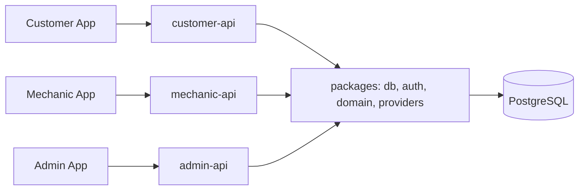

# GearZo – Tech Stack & Engineering Guidelines

> **GearZo – Mechanic in Minutes**
> This document is the single source of truth for all GearZo teams and for GitHub Copilot.
> Copilot / AI assistants: follow every rule in this file when generating code for any GearZo app.

---

## 1. Product Overview

| App | Users | Platforms | Purpose |
|---|---|---|---|
| **Customer App** | Vehicle owners and people booking for others | iOS, Android, **Web** | Find nearby mechanics, book for self or others, track, pay, rate |
| **Mechanic App** | Shops, individual mechanics, and mechanics accepting service jobs directly | Android, **Web** | Onboarding & KYC, availability, accept jobs, navigate, update status, earnings |
| **Admin App** | Internal staff (role-based) | iOS, Android, **Web** | Approve mechanics, manage bookings, disputes, reports within their jurisdiction |

Domain: **gearzo.in** (registered with BigRock).

### 1.1 Architecture – 3 apps, 3 APIs, 1 database

Each frontend app has its **own backend API**. All three APIs share **one PostgreSQL database** and shared business logic through `packages/*`.



| App | API | Domain |
|---|---|---|
| Customer App | `apps/customer-api` | `api.gearzo.in` |
| Mechanic App | `apps/mechanic-api` | `mechanic-api.gearzo.in` |
| Admin App | `apps/admin-api` | `admin-api.gearzo.in` |

**Rules:**
- An app talks **only** to its own API.
- APIs **never call each other over HTTP**. They share data through the database and shared logic through `packages/domain`.
- Cross-app updates (e.g. mechanic accepts a booking → customer sees it) go through the DB + realtime/push events (`packages/providers`).
- Business rules (booking state machine, pricing, jurisdiction scope) live **once** in `packages/domain` – never copied into an API.
- Database schema lives **only** in `packages/db` (one Prisma schema, one migration history).

---

## 2. Tech Stack

### 2.1 Frontend (all 3 apps)

| Concern | Choice |
|---|---|
| Framework | **React Native + Expo (latest SDK)**, **TypeScript (strict)** |
| Routing | **Expo Router** (file-based) |
| Server state | **TanStack Query** |
| Client state | **Zustand** |
| Forms & validation | **React Hook Form + Zod** (schemas shared from `packages/schemas`) |
| Styling / UI | **NativeWind** (Tailwind for RN) + shared components in `packages/ui` |
| Maps | Native: `react-native-maps`; web: Google Maps JavaScript API through a platform adapter; Google Places API on both |
| Location | `expo-location` (background location only in Mechanic App) |
| Notifications | `expo-notifications` (FCM / APNs) |
| Secure storage | Native: `expo-secure-store`; web: `httpOnly`, `Secure`, `SameSite=Strict` refresh-token cookies. Never store tokens in AsyncStorage or browser local storage. |
| HTTP client | `axios` wrapper in `packages/api-client` |
| i18n | `i18next` + `react-i18next` (English first, Hindi / Telugu later) |
| Builds & releases | **EAS Build / EAS Submit / EAS Update** |
| Testing | Jest + React Native Testing Library, **Maestro** for E2E |
| Web builds | Customer, Mechanic & Admin apps exported to web (`npx expo export -p web`) and hosted on Vercel |

> Use **Expo development builds**, not Expo Go (maps, background location, payments need native config).

### 2.2 Backend

| Concern | Choice |
|---|---|
| Runtime | **Node.js 20 LTS+** |
| Framework | **NestJS** (TypeScript) – modular, DI, guards for RBAC |
| Services | 3 NestJS apps: `customer-api`, `mechanic-api`, `admin-api` (see §1.1) |
| ORM | **Prisma** (single schema in `packages/db`) |
| Validation | `class-validator` DTOs at controller boundary (or Zod pipes using shared schemas) |
| Auth | JWT access token + rotating refresh token (see §5) |
| Rate limiting | `@nestjs/throttler` with **Upstash Redis** store |
| Cache / locks | **Upstash Redis** (serverless-friendly) |
| File storage | **Cloudinary** or **AWS S3** (KYC docs, vehicle photos) – private buckets + signed URLs |
| Real-time | **Pusher / Ably** (Vercel does not support long-lived WebSockets). Wrap behind `RealtimeService` so it can be swapped for Socket.IO on GCP/AWS. |
| Background jobs | Vercel Cron initially → BullMQ / Cloud Tasks after migration |
| API docs | `@nestjs/swagger` (OpenAPI) at `/docs` (disabled in production) |
| Logging | `pino` (structured JSON), no PII / tokens / OTPs in logs |
| Monitoring | **Sentry** (backend + all apps) |

### 2.3 Database

| Concern | Choice |
|---|---|
| Database | **PostgreSQL 16** |
| Hosting (now) | **Neon** (serverless Postgres, Vercel integration, pooled connections) |
| Geo queries | **PostGIS** extension (nearest mechanic search) |
| Migrations | Prisma Migrate – every schema change goes through a migration PR |
| Backups | Neon point-in-time restore; daily logical backup once in production |

### 2.4 Hosting & Infrastructure

| Item | Now | Later (migration-ready) |
|---|---|---|
| Backend APIs (3) | **Vercel** – one project per API (NestJS as serverless function) | GCP Cloud Run / AWS ECS – one service per API (Docker) |
| Customer, Mechanic & Admin web | Vercel | Same or Cloud Run / S3 + CloudFront |
| Database | Neon | Cloud SQL / RDS |
| DNS | **BigRock** (gearzo.in) | Can move to Cloudflare / Route 53 |

**DNS plan (BigRock → Vercel):**

| Subdomain | Points to |
|---|---|
| `gearzo.in` / `www.gearzo.in` | Landing page (Vercel) |
| `customer.gearzo.in` | Customer web (Vercel) |
| `api.gearzo.in` | customer-api (Vercel) |
| `mechanic-api.gearzo.in` | mechanic-api (Vercel) |
| `admin-api.gearzo.in` | admin-api (Vercel) |
| `mechanic.gearzo.in` | Mechanic web (Vercel) |
| `admin.gearzo.in` | Admin web (Vercel) |
| `staging-*.gearzo.in` | Staging versions of the above |

**Portability rules (to make GCP/AWS migration painless):**
- Keep a working `Dockerfile` for **each** API from day one.
- No Vercel-specific APIs inside business logic – only in `apps/<name>-api/api/index.ts` (the serverless entry).
- All config via environment variables; nothing hard-coded.
- Third-party services (OTP, SMS, storage, realtime, payments) always accessed through an **interface + provider** pattern.

### 2.5 Third-party services

| Service | Provider | Status |
|---|---|---|
| OTP / SMS | **MSG91** (or Twilio) | **Disabled – Mock provider in use** (see §5.2) |
| Push | Firebase Cloud Messaging / APNs via Expo | Enabled |
| Maps | Google Maps Platform | Enabled (restrict API keys by bundle ID / SHA-1 / HTTP referrer) |
| Payments | **Razorpay** | Phase 2 |
| Email | Resend / AWS SES | Admin notifications |

---

## 3. Repository Structure (Monorepo)

**Turborepo + pnpm workspaces.**

```
gearzo/
├── apps/
│   ├── customer/            # Expo – Customer App (iOS, Android, Web)
│   ├── mechanic/            # Expo – Mechanic App (Android, Web)
│   ├── admin/               # Expo – Admin App (iOS, Android, Web)
│   ├── customer-api/        # NestJS – Customer backend
│   │   ├── src/
│   │   │   ├── modules/     # auth, profile, vehicles, mechanics-search, bookings, reviews
│   │   │   ├── config/      # env validation (Zod)
│   │   │   └── main.ts
│   │   ├── api/index.ts     # Vercel serverless entry only
│   │   └── Dockerfile
│   ├── mechanic-api/        # NestJS – Mechanic backend
│   │   └── src/modules/     # auth, profile, kyc, availability, location, jobs, earnings
│   └── admin-api/           # NestJS – Admin backend
│       └── src/modules/     # auth (password + OTP + TOTP), admins, jurisdictions,
│                            # mechanics-approval, bookings, disputes, reports, audit
├── packages/
│   ├── db/                  # Prisma schema, migrations, PrismaClient (ONLY place for schema)
│   ├── auth/                # JWT/refresh token logic, OtpProvider, NestJS guards & decorators
│   ├── domain/              # Business logic: booking state machine, pricing, jurisdiction scope
│   ├── providers/           # SMS/OTP, storage, realtime, push, payments (interface + providers)
│   ├── nest-common/         # Shared Nest filters, interceptors, logger, helmet/throttler setup
│   ├── ui/                  # Shared RN components (NativeWind)
│   ├── schemas/             # Shared Zod schemas + inferred TS types
│   ├── api-client/          # Typed axios clients: customer, mechanic, admin + TanStack Query hooks
│   ├── config/              # eslint, tsconfig, tailwind presets
│   └── utils/               # Pure helpers (formatting, dates, phone)
├── .github/
│   ├── workflows/           # CI
│   └── copilot-instructions.md
├── turbo.json
├── pnpm-workspace.yaml
└── techStack.md
```

> Add `node-linker=hoisted` in `.npmrc` if Expo/Metro has trouble resolving pnpm symlinks.

**Team ownership:**

| Team | Owns |
|---|---|
| Customer team | `apps/customer`, `apps/customer-api` |
| Mechanic team | `apps/mechanic`, `apps/mechanic-api` |
| Admin team | `apps/admin`, `apps/admin-api` |
| Core / tech lead | `packages/db`, `packages/auth`, `packages/domain` |
| Shared (PR review by 2 teams) | all other `packages/*` |

> Any change to `packages/db` (schema/migrations), `packages/auth` or `packages/domain` affects **all three APIs** – needs core/tech-lead approval.

---

## 4. Roles & Access Control

### 4.1 User types

| Type | App | Login |
|---|---|---|
| `CUSTOMER` | Customer App | Mobile number + OTP only; basic profile may be skipped and collected at checkout |
| `MECHANIC` | Mechanic App | Mobile number + OTP; choose Shop, Individual Mechanic, or Accept Service Jobs Directly (+ KYC approval before taking jobs) |
| `ADMIN` | Admin App | Mobile + OTP **and** password (+ TOTP 2FA for Divisional and above) |

A single phone number may be a customer and a mechanic, but **each API only accepts tokens issued for its own app** (separate signing secrets + `aud` claim – see §5.1). A customer token is rejected by `mechanic-api` and `admin-api`.

### 4.2 Admin hierarchy (jurisdiction-based)

```
SUPER_ADMIN            → entire platform
└── DIVISIONAL_ADMIN   → one Division
    └── SUB_DIVISIONAL_ADMIN → one Sub-Division
        └── AREA_ADMIN       → one Area
```

Geography is modeled as a tree in the `jurisdictions` table:

```
Jurisdiction { id, name, level: DIVISION | SUB_DIVISION | AREA, parentId }
```

Every mechanic, booking and customer address is linked to an **Area**.

### 4.3 Authorization rules

1. **RBAC** – what an admin can do (permissions per role).
2. **Scope** – where they can do it. An admin can only see/act on records whose Area is within their jurisdiction subtree.
3. Scope filtering is applied **in the backend query layer** (`JurisdictionScopeGuard` from `packages/auth` + scoped query helpers from `packages/domain`). Never trust a jurisdiction ID sent by the client.
4. An admin can only create/manage admins **below** their own level and inside their own subtree.
5. Every admin write action is recorded in `audit_logs` (who, what, when, before/after, IP).

| Permission | SUPER | DIVISIONAL | SUB_DIVISIONAL | AREA |
|---|---|---|---|---|
| Manage jurisdictions | ✅ | ❌ | ❌ | ❌ |
| Create admins (lower level, own subtree) | ✅ | ✅ | ✅ | ❌ |
| Approve / suspend mechanics | ✅ | ✅ | ✅ | ✅ |
| View / manage bookings | ✅ | ✅ | ✅ | ✅ |
| Resolve disputes & refunds | ✅ | ✅ | ✅ | ❌ |
| Pricing & service catalogue | ✅ | ❌ | ❌ | ❌ |
| Reports | All | Division | Sub-Division | Area |

> Full permission codes, approval limits and Super Admin features: `individual-satck.md` Part 4.

---

## 5. Security

### 5.1 Authentication

- **Access token:** JWT, 15 min expiry, signed with RS256 (or HS256 with ≥ 256-bit secret). Claims: `sub`, `role`, `aud` (`customer` | `mechanic` | `admin`), `jurisdictionId` (admins), `tokenVersion`.
- **Each API has its own signing secret** and verifies `aud`. A leaked customer-api secret can never mint admin tokens.
- Refresh tokens are stored per app (`app` column) and only accepted by the API that issued them.
- **Refresh token:** opaque random 256-bit value, **stored hashed (SHA-256) in DB**, rotated on every use, sliding expiry with idle + absolute timeouts and max active sessions per app (see `individual-satck.md` §1.0.6). Reuse of an old refresh token ⇒ revoke the whole token family.
- Tokens stored in **`expo-secure-store`** on native devices. Customer, Mechanic and Admin web use `httpOnly`, `Secure`, `SameSite=Strict` refresh-token cookies; access tokens remain in memory.
- Logout and "logout all devices" revoke refresh tokens and bump `tokenVersion`.
- Admin passwords: **argon2id**, min 10 chars, breached-password check optional.
- Admin TOTP 2FA (`otplib`) mandatory for `DIVISIONAL_ADMIN` and `SUPER_ADMIN`.

### 5.2 OTP login (Mock now, real provider later)

OTP is implemented with a **provider pattern** – switch via environment variable, **no commenting/uncommenting code**.

```ts
// packages/auth/src/otp/otp.provider.ts
export interface OtpProvider {
  send(phone: string, otp: string): Promise<void>;
}
```

| `OTP_PROVIDER` | Behaviour |
|---|---|
| `mock` | No SMS sent. OTP is always `MOCK_OTP_CODE` (default `123456`). |
| `msg91` | Real SMS via MSG91 (enable when budget allows). |

**OTP rules (apply to mock AND real):**
- 6 digits, generated with `crypto.randomInt` (real provider).
- Stored **hashed** in DB/Redis with 5-minute expiry; single use.
- Max **5 verify attempts** per OTP, then invalidate.
- Max **3 sends per phone per 15 min** and per-IP rate limit.
- Resend cooldown 30 s.
- Never log or return the OTP in API responses.
- Generic error messages ("Invalid or expired OTP") – don't reveal whether a phone is registered.

**Mock safety guard:** at startup **each** API must **refuse to boot** if `OTP_PROVIDER=mock` and `NODE_ENV=production`, unless `ALLOW_MOCK_OTP_IN_PROD=true` is explicitly set (pilot/demo only). When mock is active, log a warning on every boot.

**Going live:** set `OTP_PROVIDER=msg91`, add `MSG91_AUTH_KEY` and `MSG91_TEMPLATE_ID`, redeploy. No code changes.

### 5.3 API security checklist (OWASP)

- `helmet` security headers; HTTPS only (HSTS).
- **CORS allowlist per API**: `admin-api` → `https://admin.gearzo.in`; `mechanic-api` → `https://mechanic.gearzo.in`; `customer-api` → `https://customer.gearzo.in`. Plus staging origins.
- **admin-api hardening**: stricter rate limits, mandatory audit logging, shorter sessions; IP allowlist / VPN once on GCP/AWS. Swagger never exposed publicly.
- Validate **every** request body/query/param (whitelist + forbid unknown properties).
- Prisma only – **no raw SQL with string interpolation**. If raw SQL is required, use `Prisma.sql` tagged templates.
- Object-level authorization on every resource (customer can only read own bookings; mechanic only assigned jobs; admin only in jurisdiction). Use UUIDs for IDs.
- Global rate limiting + stricter limits on `/auth/*` and `/otp/*`.
- File uploads: allowlisted MIME types, size limit, virus scan later, private storage, signed URLs with short expiry.
- Global exception filter – never leak stack traces or DB errors to clients.
- Secrets only in Vercel / cloud secret manager. `.env*` files are git-ignored; commit `.env.example` only.
- Dependency scanning: `pnpm audit` + GitHub Dependabot; CodeQL in CI.
- PII (phone, address, KYC docs) encrypted at rest (provider-level) and masked in admin lists where full value isn't needed.
- Payment (phase 2): verify Razorpay webhook signatures; amounts computed server-side only.

### 5.4 Native and web app security

- No secrets in the app bundle (only public keys: Maps key restricted by bundle ID, Sentry DSN).
- `EXPO_PUBLIC_*` env vars are public – never put secrets there.
- On native apps, tokens only in `expo-secure-store`.
- On web, keep access tokens in memory and refresh tokens only in secure `httpOnly` cookies; never use local storage for either token.
- Disable logging of sensitive data in release builds.
- Request permissions just-in-time with clear reasons (location, camera, notifications).
- Consider certificate pinning and root/jailbreak detection before public launch.
- Follow **OWASP MASVS** for release reviews.

---

## 6. API Conventions

- Base URLs:
  - Customer: `https://api.gearzo.in/v1`
  - Mechanic: `https://mechanic-api.gearzo.in/v1`
  - Admin: `https://admin-api.gearzo.in/v1`
- REST, JSON, `camelCase` fields, plural resource nouns: `/v1/bookings/:id`.
- All three APIs use the **same response format, error codes and conventions** (from `packages/nest-common`).
- Standard response:
  ```json
  { "success": true, "data": { }, "meta": { "page": 1, "limit": 20, "total": 120 } }
  ```
  Error:
  ```json
  { "success": false, "error": { "code": "BOOKING_NOT_FOUND", "message": "Booking not found" } }
  ```
- Pagination: `?page=&limit=` (max 100).
- Timestamps in **UTC ISO-8601**; display in IST on clients.
- Money in **paise (integer)** – never floats.
- Phone numbers stored in **E.164** (`+91XXXXXXXXXX`).
- Idempotency-Key header for booking creation and payments.

### Core endpoints (initial)

| API | Endpoints |
|---|---|
| **customer-api** | `POST /auth/otp/send`, `POST /auth/otp/verify`, `POST /auth/refresh`, `POST /auth/logout`, `GET/PATCH /me`, `POST /me/profile`, `POST /me/profile/skip`, `GET /me/feature-flags`, `CRUD /vehicles`, `CRUD /addresses`, `GET /home`, `GET /services`, `GET /mechanics/nearby?lat&lng&serviceId`, `POST /bookings/quote`, `POST /coupons/validate`, `POST /bookings` (self or other recipient), `GET /bookings?status=`, `GET /bookings/:id`, `POST /bookings/:id/cancel`, `POST /bookings/:id/extras/:extraId/approve`, `POST /bookings/:id/rebook`, `POST /bookings/:id/review`, `GET /bookings/:id/invoice`, `GET /subscription-plans`, `GET /me/subscriptions` |
| **mechanic-api** | `POST /auth/otp/send`, `POST /auth/otp/verify`, `POST /auth/refresh`, `POST /auth/logout`, `GET/PATCH /me`, `PUT /onboarding/type`, `POST /kyc`, `PATCH /availability`, `POST /location`, `GET /jobs`, `GET /jobs/:id`, `PATCH /jobs/:id/status`, `GET /earnings` |
| **admin-api** | `POST /auth/login`, `POST /auth/otp/verify`, `POST /auth/2fa/verify`, `POST /auth/refresh`, `POST /auth/logout`, `/mechanics` (approve/suspend), `/bookings`, `/disputes`, `/admins`, `/jurisdictions`, `/services` (catalogue & pricing), `/reports`, `/audit-logs` |

### Booking status flow

```
REQUESTED → ACCEPTED → EN_ROUTE → ARRIVED → IN_PROGRESS → COMPLETED
     ↘ CANCELLED (by customer / mechanic / admin)   ↘ DISPUTED
```
Status transitions are validated by a single state-machine function in `packages/domain`, used by all three APIs.

---

## 7. Environment Variables

Each API has its own `apps/<name>-api/.env.example` (same keys, different values).

```bash
NODE_ENV=development
PORT=4001                              # customer 4001 | mechanic 4002 | admin 4003
APP_AUDIENCE=customer                  # customer | mechanic | admin
DATABASE_URL=postgresql://...          # Neon pooled URL (same DB for all 3)
DIRECT_URL=postgresql://...            # Neon direct URL (migrations – packages/db only)
JWT_ACCESS_SECRET=                     # UNIQUE per API – never reuse
JWT_ACCESS_TTL=15m                     # admin-api: 10m
# Security limits: code defaults in packages/auth/src/limits.config.ts,
# overridable by LIMIT_* env vars or by SUPER_ADMIN (system_settings) – see individual-satck.md §1.0.7
CORS_ORIGINS=                          # see §5.3
REDIS_URL=                             # Upstash
OTP_PROVIDER=mock                      # mock | msg91
MOCK_OTP_CODE=123456
ALLOW_MOCK_OTP_IN_PROD=false
MSG91_AUTH_KEY=
MSG91_TEMPLATE_ID=
GOOGLE_MAPS_SERVER_KEY=
PAYMENT_PROVIDER=mock                  # mock | razorpay (customer-api)
RAZORPAY_KEY_ID=
RAZORPAY_KEY_SECRET=
RAZORPAY_WEBHOOK_SECRET=
STORAGE_PROVIDER=cloudinary            # cloudinary | s3
REALTIME_PROVIDER=pusher               # pusher | ably | socketio
SENTRY_DSN=
```

Frontend apps (`apps/*/.env.example`):

```bash
EXPO_PUBLIC_API_URL=https://api.gearzo.in/v1   # mechanic-api / admin-api URL in those apps
EXPO_PUBLIC_WEB_ORIGIN=https://customer.gearzo.in # use the matching app origin
EXPO_PUBLIC_GOOGLE_MAPS_KEY=           # restricted by bundle ID / SHA-1
EXPO_PUBLIC_SENTRY_DSN=
```

Env vars are validated at boot with Zod (`apps/<name>-api/src/config/env.ts`, shared schema in `packages/nest-common`) – each API must fail fast on missing/invalid values.

---

## 8. Coding Standards

### General
- **TypeScript strict mode** everywhere. No `any` (use `unknown` + narrowing).
- ESLint + Prettier (shared config in `packages/config`). CI fails on lint/type errors.
- File names: `kebab-case.ts`; React components: `PascalCase.tsx`; hooks: `useSomething.ts`.
- Shared request/response shapes live in `packages/schemas` – don't duplicate types across apps.
- Comments only for *why*, not *what*.

### React Native
- Functional components + hooks only.
- Data fetching only through hooks in `packages/api-client` (TanStack Query) – no `fetch` in screens.
- Screens in `app/` (Expo Router); reusable UI in `components/` or `packages/ui`.
- Handle loading, empty, and error states on every screen.
- Accessibility: `accessibilityLabel` on all touchables, min touch target 44×44.

### NestJS
- One feature = one module (`controller`, `service`, `dto`, `*.spec.ts`).
- Controllers are thin; app-specific orchestration in services; **shared business rules in `packages/domain`**.
- If logic is needed by 2+ APIs, move it to `packages/domain` – never copy-paste between APIs.
- Use guards/decorators from `packages/auth`: `@Roles()`, `@CurrentUser()`, `@Public()`, `JurisdictionScopeGuard`.
- All DB access via `PrismaClient` from `packages/db`; wrap multi-step writes in `prisma.$transaction`.
- An API must not import from another API's folder (`apps/*-api`). Enforce with ESLint `no-restricted-imports`.

### Git workflow
- Branches: `main` (production), `develop` (staging), `feature/<app>-<short-desc>`, `fix/<app>-<short-desc>`.
- **Conventional Commits**: `feat(customer): add booking screen`, `fix(customer-api): otp rate limit`, `feat(db): add disputes table`.
- PRs require 1 approval (2 for `packages/*`; core/tech lead for `packages/db`, `packages/auth`, `packages/domain`), passing CI, no direct pushes to `main`/`develop`.
- CI (Turborepo) builds and tests only affected apps; a change in `packages/*` runs tests for all 3 APIs.

### Testing
- Backend: unit tests for `packages/domain` and services; e2e tests per API for auth, OTP, bookings, admin scope (Supertest).
- Cross-API test: a token from one API must be rejected by the other two.
- Apps: component tests for critical flows; Maestro E2E for mobile login → skip profile → booking, plus Playwright/browser E2E for customer and mechanic web flows.
- Security-critical code (auth, OTP, RBAC/scope) must have tests before merge.

---

## 9. Environments

| Env | customer-api | mechanic-api | admin-api | DB | OTP |
|---|---|---|---|---|---|
| Local | `localhost:4001` | `localhost:4002` | `localhost:4003` | Local Postgres (Docker) / Neon branch | mock |
| Staging | `staging-api.gearzo.in` | `staging-mechanic-api.gearzo.in` | `staging-admin-api.gearzo.in` | Neon `staging` branch | mock |
| Production | `api.gearzo.in` | `mechanic-api.gearzo.in` | `admin-api.gearzo.in` | Neon `main` | msg91 (once enabled) |

---

## 10. Roadmap

| Phase | Scope |
|---|---|
| **1 – MVP** | Mock OTP mobile-number login, skippable customer profile, booking for self/others, shop/individual/direct-job mechanic onboarding, mechanic accept/complete, admin approvals with role hierarchy, push notifications |
| **2** | Real OTP (MSG91), Razorpay payments & mechanic payouts, live tracking, ratings, subscription plan purchase & redemption, rewards |
| **3** | Migrate the 3 APIs to GCP Cloud Run / AWS ECS, admin-api behind VPN/IP allowlist, Redis queues, analytics dashboards, multi-language. Extract hot modules (e.g. tracking, notifications) into separate services only if traffic requires it. |

---

## 11. Instructions for GitHub Copilot

When generating code for GearZo:
1. Use the stack in §2 only. Don't introduce new libraries without noting it in the PR.
2. Respect the architecture in §1.1 and monorepo layout in §3: each app calls only its own API; APIs never call each other or import from each other.
3. Shared business logic goes in `packages/domain`, DB schema only in `packages/db`, auth in `packages/auth` – never duplicate across APIs.
4. Enforce auth (correct `aud`), RBAC **and** jurisdiction scope on every admin-api endpoint (§4).
5. Follow security rules in §5 – never log/return OTPs or tokens, never hard-code secrets, validate all input.
6. OTP must go through `OtpProvider`; never bypass it or hard-code `123456` outside `MockOtpProvider`.
7. Follow API conventions (§6) and coding standards (§8).
8. Keep code platform-agnostic so the APIs can move from Vercel to GCP/AWS without rewrites.